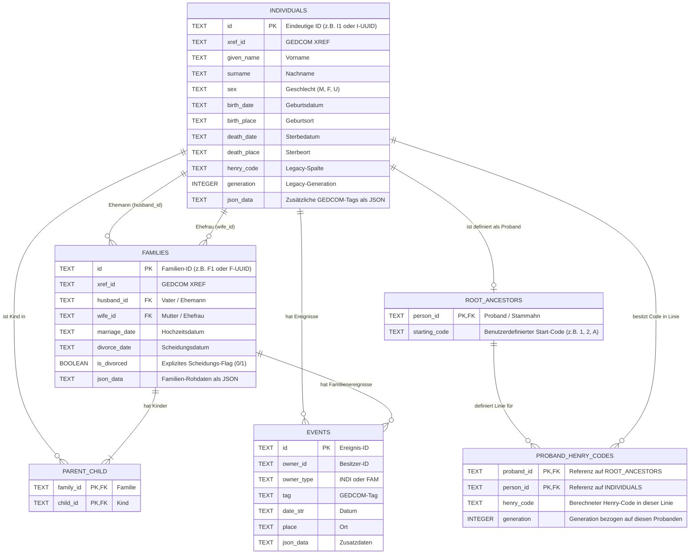

# Anforderungsdokumentation: Froning Familienbuch (Stammbaum-Applikation)

**Dokument-Version:** 2.1.0  
**Status:** Aktualisierte Ist-Stand-Dokumentation (Korrektur Henry-Berechnung, GEDCOM-Import, Verwandtschafts-Editierung mit Rekursionsprüfung, Stammbaum-Löschung)  
**Datum:** 27. Oktober 2026  
**Systemtyp:** Desktop-Applikation (Tauri v2 + Vue 3 + TypeScript + SQLite)

---

## 1. Einleitung & Zielsetzung

### 1.1 Zweck des Dokuments
Dieses Dokument beschreibt die aktualisierten fachlichen und technischen Anforderungen, die Systemarchitektur, das erweiterte Datenmodell sowie den Funktionsumfang der Desktop-Anwendung **Froning Familienbuch** (*stammbaum*).

### 1.2 Produktvision & Kernkonzept
Das *Froning Familienbuch* ist eine plattformübergreifende Desktop-Software zur Erfassung, Verwaltung, interaktiven Visualisierung und Auswertung genealogischer Daten.  
Besondere Merkmale der Version 2.1:
- **Multi-Probanden-System:** Beliebig viele Stammahnen mit individuellen Start-Codes (z. B. `1`, `2`, `A`) können parallel definiert werden.
- **Kompakte & korrekte Henry-Berechnung:** Patrilineare Vererbung (über den Vater bzw. bei weiblichem Stammahn über die Mutter) mit strikter Zyklen-/Rekursionsvermeidung und chronologischer Sortierung der Geschwister nach Geburtsjahr.
- **Verwandtschafts-Editierung im Edit Mode:** Interaktive Zuweisung oder Korrektur von Vater und Mutter direkt in der Detailansicht inklusive automatischer, tiefgehender **Rekursionsprüfung** (Verhinderung zyklischer Verwandtschaften).
- **Sichere Stammbaum-Löschung:** Zweistufige Sicherheitsabfrage mit optisch hervorgehobenem und per Vorauswahl fokussiertem "Abbrechen"-Button zum Schutz vor versehentlicher Bestätigung.
- **Robuster GEDCOM-Import:** Vollständige und transaktionale Übernahme von Personen, Familien und Eltern-Kind-Relationen (`parent_child`) aus `CHIL`- und `FAMC`-Einträgen.
- **Interaktiver Canvas-Stammbaum:** Stufenloses Panning & Zooming, Cluster für Ehepartner und Eltern mit Heirats-/Scheidungslinien sowie klickbaren Ast-Sprüngen.

---

## 2. Systemarchitektur & Technologie-Stack

### 2.1 Architekturschaubild (Mermaid – direkt kompatibel mit draw.io)

> **Hinweis für draw.io (diagrams.net):**  
> Kopieren Sie den folgenden Codeblock über das Menü **Anordnen -> Einfügen -> Erweitert -> Mermaid...** (*Arrange -> Insert -> Advanced -> Mermaid...*) direkt in draw.io.

```mermaid
flowchart TB
    subgraph UI ["Präsentationsschicht (Frontend: Vue 3 + TypeScript + Vite)"]
        direction TB
        AppVue["App.vue (Hauptanwendung & State)"]
        
        subgraph Views ["Ansichten & Interaktion"]
            ProbandTabs["Probanden-Tabs (Alle Sichten / Stammahnen)"]
            TableView["Tabellen-Ansicht (Sortierung, Datums-/Textfilter, Inline-Edit)"]
            TreeCanvas["Stammbaum-Canvas (Pan & Zoom Viewport, Personensuche)"]
            TreeNodeComp["TreeNode.vue (Rekursive Knoten, Eltern- & Ehepartner-Cluster)"]
            DetailsDrawer["Detail-Panel / Slide-Over Drawer (Lebensdaten, Eltern-Editor, Notizen)"]
        end

        subgraph Modals ["Modale Dialoge"]
            AddPersonModal["Personen-Dialog (Unabhängige Person / Kind / Elternteil / Partner)"]
            DeleteTreeModal["2-Stufen Lösch-Dialog (Autofokus & Highlight auf Abbrechen)"]
            SettingsModal["Konfigurations-Dialog (Spalten, Stammbaum-Manager, Probanden)"]
        end

        I18n["Vue I18n (Lokalisierung DE / EN)"]
    end

    subgraph IPC ["Tauri v2 IPC Bridge (Asynchrone Kommandos & Dialoge)"]
        TauriInvoke["invoke() JSON-RPC Schnittstelle"]
        TauriDialog["@tauri-apps/plugin-dialog (Dateiauswahl)"]
    end

    subgraph Backend ["Applikationsschicht (Backend: Rust 2024 / src-tauri)"]
        direction TB
        LibRs["lib.rs (Tauri Command Handler & AppState Mutex)"]
        
        subgraph DomainServices ["Fachlogik & Algorithmen"]
            HenryCalc["Multi-Probanden Henry-Engine (Patrilinear & Geburtsjahr-Sortierung)"]
            RecursionCheck["check_parent_recursion (Zyklus- & Rekursionsprüfung)"]
            GedcomParser["parser.rs (GEDCOM 5.5 Stream-Parser & Relationen-Extraktion)"]
            GraphEngine["petgraph Engine (A* Kürzester Beziehungspfad)"]
            LatexExport["Tera Template Engine & pdflatex (Chronik-PDF)"]
        end

        DbModule["db.rs (Schema-Initialisierung & Auto-Migration)"]
    end

    subgraph Storage ["Datenhaltungsschicht (Lokales Dateisystem)"]
        SQLiteDB[("SQLite Datenbanken (*.db, *.db-wal, *.db-shm im AppData-Verzeichnis)")]
        GedcomFiles["GEDCOM-Dateien (*.ged)"]
        PdfFiles["Generierte Chroniken (.tex / .pdf)"]
    end

    AppVue --> ProbandTabs
    AppVue --> TableView
    AppVue --> TreeCanvas
    TreeCanvas --> TreeNodeComp
    AppVue --> DetailsDrawer
    AppVue --> AddPersonModal
    AppVue --> DeleteTreeModal
    AppVue --> SettingsModal
    AppVue -.-> I18n

    AppVue <--> TauriInvoke
    AppVue --> TauriDialog
    TauriDialog --> GedcomFiles

    TauriInvoke <--> LibRs
    LibRs --> HenryCalc
    LibRs --> RecursionCheck
    LibRs --> GedcomParser
    LibRs --> GraphEngine
    LibRs --> LatexExport
    LibRs --> DbModule

    GedcomParser --> GedcomFiles
    LatexExport --> PdfFiles
    DbModule <--> SQLiteDB
    HenryCalc <--> SQLiteDB
    RecursionCheck <--> SQLiteDB
    GedcomParser <--> SQLiteDB
    GraphEngine <--> SQLiteDB
```

---

## 3. Datenmodell & Datenbankdesign

Jeder Stammbaum wird als eigenständige SQLite-Datenbankdatei (`<tree_name>.db`) im App-Datenverzeichnis gespeichert.

### 3.1 Entity-Relationship-Diagramm

---

## 4. Funktionale Anforderungen (Ist-Zustand v2.1)

### FA-01: Multi-Stammbaum-Verwaltung & Sicheres Löschen
- **FA-01.1 Auflisten & Wechseln:** Auflistung vorhandener Stammbäume (`get_trees`) und unterbrechungsfreier Wechsel (`switch_tree`).
- **FA-01.2 Vollständiges & Isoliertes Entfernen (`delete_tree`):**
  - Ein Stammbaum kann über die Einstellungen komplett entfernt werden.
  - **Sichere Dateifreigabe:** Vor dem Löschen wird die aktive SQLite-Verbindung per WAL-Checkpoint synchronisiert und auf eine In-Memory-Instanz umgehängt, damit alle Dateilocks unter Windows zuverlässig freigegeben werden.
  - **Physische Löschung aller zugehörigen Dateien:** Alle zum Stammbaum gehörenden Datenbankdateien (`<tree_name>.db`, `<tree_name>.db-wal`, `<tree_name>.db-shm`, `<tree_name>.db-journal` und ggf. `<tree_name>.sqlite*`) werden physisch von der Festplatte gelöscht (inklusive Retry-Mechanismus bei verzögerter Betriebssystem-Freigabe).
  - **Schutz anderer Stammbäume:** Datenbankdateien und Daten anderer Stammbäume werden strikt isoliert und bleiben unangetastet.
  - **Automatischer Fallback & Leerzustand nach letzter Löschung:**
    - Wenn weitere Stammbäume existieren, wird auf den nächsten verbleibenden Stammbaum gewechselt.
    - War der gelöschte Stammbaum der letzte/einzige vorhandene, wird **kein** Stammbaum neu angelegt (`remaining_trees = []`, `activeTree = ''`), die Verbindung verbleibt auf einer leeren In-Memory-Datenbank, im Konfigurationsfenster wird *"Kein aktiver Stammbaum vorhanden"* angezeigt und der Button *"Stammbaum entfernen"* wird ausgeblendet.
    - Beim nächsten GEDCOM-Import ohne aktiven Stammbaum wird automatisch ein neuer Stammbaum mit dem Dateinamen der GEDCOM-Datei angelegt.
  - **Vollständiger Frontend-State-Reset:** Sämtliche im UI gehaltenen Daten des gelöschten Baums (Personenliste, Probanden-Tabs, ausgewählte Person, Detailansicht, Eltern-/Kind-Relationen, Baumwurzeln, Editierstände, Such- und Spaltenfilter) werden restlos geleert. Die App zeigt nach dem Löschen keinerlei Altdaten des entfernten Stammbaums mehr an.
- **FA-01.3 2-Stufen-Sicherheitsabfrage im UI:**
  - **Stufe 1:** *"Soll der ausgewählte Stammbaum «Name Stammbaum» entfernt werden?"* (Optionen: "Bestätigen" und "Abbrechen").
  - **Stufe 2:** *"Der ausgewählte Stammbaum «Name Stammbaum» wird endgültig entfernt."* (Optionen: "Bestätigen" und "Abbrechen").
  - **Modale Schichtung (Z-Index 1200):** Der Bestätigungsdialog wird optisch und schichtungstechnisch über dem Konfigurationsfenster gerendert und dunkelt dieses im Hintergrund ab.
  - **Fehlbedienungsschutz:** Bei beiden Stufen ist der **"Abbrechen"-Button optisch stark hervorgehoben** (hervorgehobene Farbe, Rahmen, Schatten) und wird **automatisch vorselektiert (Autofokus)**. Versehentliches Drücken der Eingabe- oder Leertaste bricht den Löschvorgang sofort sicher ab.

### FA-02: Robuster GEDCOM-Import & Beziehungs-Extraktion
- **FA-02.1 Atomare Bereinigung:** Vor dem Import werden alle Tabellen des aktuellen Stammbaums atomar in einer Transaktion geleert (`DELETE FROM proband_henry_codes`, `parent_child`, `families`, `individuals`).
- **FA-02.2 Verlässliche Eltern-Kind-Verknüpfungen:**
  - Extrahiert Kinder sowohl aus `FAM`-Blöcken (`1 CHIL @I...@`) als auch aus `INDI`-Blöcken (`1 FAMC @F...@`).
  - Schreibt alle eindeutigen Paare verlässlich in die Tabelle `parent_child`.
- **FA-02.3 Lebens- und Ehedaten:** Extrahiert Namen, Geschlecht, Geburts-/Sterbedaten und -orte sowie Hochzeits- und Scheidungsdaten (`DIV`, `DIV_DATE`).

### FA-03: Multi-Probanden & Korrekte Henry-Code-Berechnung
- **FA-03.1 Parallele Probanden:** Verwaltung mehrerer Stammahnen mit frei wählbarem Start-Code (`starting_code`) über den Einstellungsdialog.
- **FA-03.2 Korrigierte Familien-Zuordnung:**
  - Bei der BFS-Traversierung wird eine Familie ausschließlich dann als Nachkommenquelle herangezogen, wenn die aktuelle Person tatsächlich der Vater (`husband_id`) oder bei einer Stammahnin/Alleinstehenden die Mutter (`wife_id`) dieser konkreten Familie ist.
  - Behebt das Fehlverhalten, bei dem Vorfahren oder fremde Familienzweige fälschlicherweise als Kinder des Probanden erfasst wurden.
- **FA-03.3 Zyklenschutz:** Vorfahren oder bereits besuchte Personen werden niemals erneut als Kinder aufgenommen (`!visited.contains(c)`).
- **FA-03.4 Chronologische Sortierung:** Geschwister werden vor der Vergabe der Ziffern/Buchstaben streng nach Geburtsjahr sortiert.

### FA-04: Verwandtschafts-Editierung im Edit Mode mit Rekursionsprüfung
- **FA-04.1 Eltern-Editor in der Detailansicht:**
  - Im aktivierten Edit Mode ("Tabelle editieren") steht im Detail-Panel der Bereich *"Eltern bearbeiten"* zur Verfügung.
  - Ermöglicht die getrennte Auswahl von **Vater** und **Mutter** aus dropdown-gefilterten Personenlisten (oder Entfernen eines Elternteils).
- **FA-04.2 Tiefgehende Rekursionsprüfung (`check_parent_recursion`):**
  - Vor dem Speichern prüft das Backend per Breitensuche über die Vorfahrenlinien des vorgeschlagenen Elternteils, ob die zu bearbeitende Person bereits ein Vorfahre des Kandidaten ist (oder Selbstreferenz).
  - Wird ein Zyklus/eine Rekursion erkannt, bricht die Operation ab und gibt eine verständliche Fehlermeldung zurück.
- **FA-04.3 UI-Hinweis & Abbruch:**
  - Bei Rekursion wird die Änderung **nicht gespeichert**.
  - Im UI erscheint eine gut sichtbare Warnmeldung (`⚠️ Rekursion erkannt...`).
- **FA-04.4 Transaktionales Speichern & Auto-Neuberechnung:**
  - Bei gültiger Änderung wird die Verknüpfung in `parent_child` und `families` transaktional aktualisiert.
  - Anschließend werden die Henry-Codes aller definierten Probanden sofort automatisch neu berechnet.

### FA-05: Interaktiver Canvas-Stammbaum & Seitenast-Cluster
- **FA-05.1 Infinite Canvas:** Stufenloser Pan & Zoom (`20%` - `250%`) mit schwebender Zoomleiste und Reset-Navigation.
- **FA-05.2 Seitenäste:** Ein- und Ausblenden von Ehepartnern (horizontal mit roter Verbindungslinie und Ehedaten) und Eltern (vertikal über gestrichelter Linie).
- **FA-05.3 Ast-Sprung & Eltern-Laden:** Klickbare Badges auf Seitenästen und Eltern-Nachlade-Button (`🔼`) an der Baumwurzel.

---

## 5. Schnittstellenspezifikation (Tauri IPC-Kommandos)

| IPC-Kommando (`invoke`) | Parameter | Rückgabewert | Beschreibung |
| :--- | :--- | :--- | :--- |
| `get_trees` | *keine* | `Result<Vec<String>, String>` | Listet alle `.db`-Stammbäume im AppData-Ordner. |
| `switch_tree` | `treeName` | `Result<(), String>` | Wechselt die aktive SQLite-Datenbank. |
| `delete_tree` | `treeName` | `Result<Vec<String>, String>` | Löscht eine SQLite-Datenbank inkl. WAL/SHM sicher. |
| `get_all_persons` | *keine* | `Result<Vec<Person>, String>` | Lädt alle Personen inkl. `proband_data`, `spouses` und `parent_ids`. |
| `get_person_details` | `personId` | `Result<PersonDetailsResponse, String>` | Lädt Detailrelationen, Notizen und GEDCOM-Tags. |
| `update_person_parents` | `personId`, `fatherId`, `motherId` | `Result<(), String>` | Prüft Rekursion, aktualisiert Eltern und berechnet Henry-Codes neu. |
| `get_root_ancestors` | *keine* | `Result<Vec<RootAncestorConfig>, String>` | Lädt alle konfigurierten Probanden. |
| `add_root_ancestor` | `personId`, `startingCode` | `Result<(), String>` | Legt einen neuen Probanden fest. |
| `remove_root_ancestor` | `personId` | `Result<(), String>` | Entfernt einen Probanden. |
| `calculate_henry_codes_from_roots` | *keine* | `Result<(), String>` | Berechnet Henry-Codes für alle Probanden (patrilinear, chronologisch). |
| `add_person` | `targetPersonId`, `relationType`, `givenName`, `surname`, `sex`, `birthDate`, `birthPlace`, `deathDate`, `deathPlace` | `Result<String, String>` | Legt eine Person (unabhängig oder als Verwandten) an. |
| `update_person` | `person` | `Result<(), String>` | Aktualisiert Vorname, Nachname und Geschlecht einer Person. |
| `import_gedcom_file` | `filePath` | `Result<usize, String>` | Bereinigt den Baum atomar und importiert Personen, Familien und Relationen. |
| `find_relationship_path` | `startId`, `targetId` | `Result<Vec<String>, String>` | Kürzester Beziehungspfad via A* (`petgraph`). |
| `export_latex_pdf` | `outputDir` | `Result<String, String>` | Rendert `chronik.tex` via `tera` und kompiliert `chronik.pdf`. |
