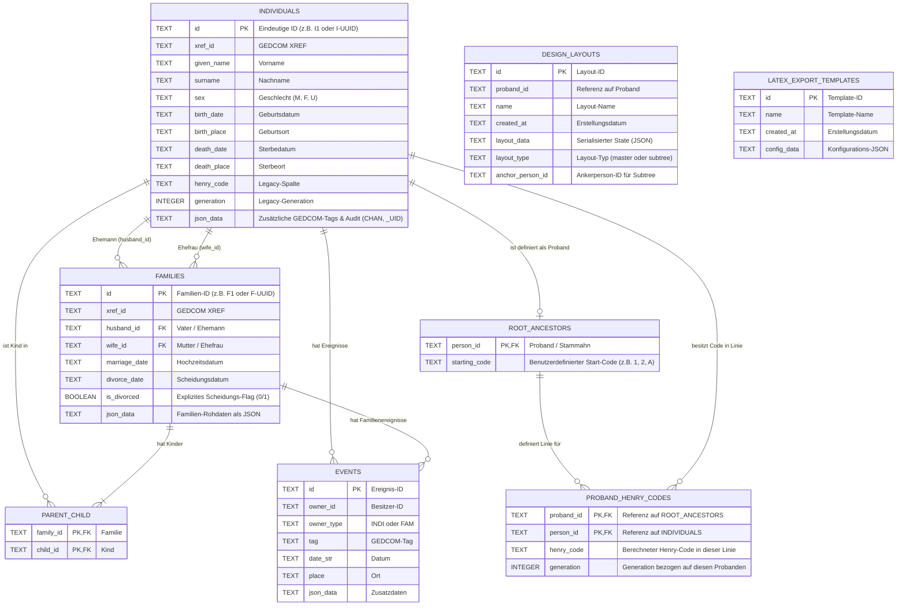

# Systemarchitektur & Traceability-Matrix (Architecture)

**System:** LineageGraph (Froning Familienbuch)  
**Dokument-Version:** 3.0.0  
**Status:** Freigegebener Ist-Stand  
**Datum:** 5. November 2026  
**Referenzierte Dokumente:** [REQ.md](file:///c:/dev/Froning/app/LineageGraph/REQ.md), [SPEC.md](file:///c:/dev/Froning/app/LineageGraph/SPEC.md)

---

## 1. Systemarchitektur & Technologie-Stack

LineageGraph basiert auf einer hybriden Desktop-Architektur (Tauri v2), die ein schlankes, reaktives Web-Frontend mit einem performanten, speichersicheren Rust-Backend kombiniert.

### 1.1 Schichten-Übersicht

```
+-------------------------------------------------------------------------+
|                  Präsentationsschicht (Frontend)                        |
|  Vue 3 (Composition API) | TypeScript | HTML5 Canvas & SVG | Vue-I18n   |
+-------------------------------------------------------------------------+
                                    |
            IPC-Bridge: @tauri-apps/api/core::invoke() (JSON-RPC)
            System-Plugins: @tauri-apps/plugin-dialog, plugin-opener
                                    v
+-------------------------------------------------------------------------+
|                  Applikationsschicht (Rust Backend)                     |
|  Tauri v2 Command Handler | Mutex State | petgraph | Tera | chrono      |
+-------------------------------------------------------------------------+
                                    |
                           rusqlite (WAL-Mode)
                                    v
+-------------------------------------------------------------------------+
|                  Datenhaltungsschicht (Dateisystem)                     |
|  Lokale SQLite-Datenbanken (*.db) im Betriebssystem-AppData-Ordner      |
+-------------------------------------------------------------------------+
```

---

## 2. Traceability-Matrix

Die folgende Matrix bildet die lückenlose Verbindung zwischen den fachlichen Anforderungen ([REQ.md](file:///c:/dev/Froning/app/LineageGraph/REQ.md)), den technischen Spezifikationen ([SPEC.md](file:///c:/dev/Froning/app/LineageGraph/SPEC.md)), den architektonischen Schichten und den konkreten Quellcode-Dateien ab:

| REQ-ID | Fachliche Anforderung | SPEC-ID | Schicht | Betroffene Quellcodedateien (Frontend & Backend) |
| :--- | :--- | :--- | :--- | :--- |
| **[REQ-TRM-001](file:///c:/dev/Froning/app/LineageGraph/REQ.md#req-trm-001-multi-stammbaum-verwaltung--umschaltung)** | Multi-Stammbaum-Verwaltung & Umschaltung | [SPEC-TRM-001](file:///c:/dev/Froning/app/LineageGraph/SPEC.md#spec-trm-001---req-trm-001) | Backend / Composable / UI | [`src-tauri/src/lib.rs`](file:///c:/dev/Froning/app/LineageGraph/src-tauri/src/lib.rs), [`src/composables/usePersons.ts`](file:///c:/dev/Froning/app/LineageGraph/src/composables/usePersons.ts), [`src/components/modals/SettingsModal.vue`](file:///c:/dev/Froning/app/LineageGraph/src/components/modals/SettingsModal.vue) |
| **[REQ-TRM-002](file:///c:/dev/Froning/app/LineageGraph/REQ.md#req-trm-002-zweistufige-sicherheitsl%C3%B6schung-mit-prozess-schutz)** | 2-Stufen-Sicherheitslöschung mit Prozess-Schutz | [SPEC-TRM-002](file:///c:/dev/Froning/app/LineageGraph/SPEC.md#spec-trm-002---req-trm-002) | Backend / UI-Modal / State | [`src-tauri/src/lib.rs`](file:///c:/dev/Froning/app/LineageGraph/src-tauri/src/lib.rs), [`src/components/modals/DeleteTreeModal.vue`](file:///c:/dev/Froning/app/LineageGraph/src/components/modals/DeleteTreeModal.vue) |
| **[REQ-TRM-003](file:///c:/dev/Froning/app/LineageGraph/REQ.md#req-trm-003-automatischer-fallback--leerzustands-behandlung)** | Leerzustands-Handling & Fallback | [SPEC-TRM-003](file:///c:/dev/Froning/app/LineageGraph/SPEC.md#spec-trm-003---req-trm-003) | Backend / App-Orchestrierung | [`src-tauri/src/lib.rs`](file:///c:/dev/Froning/app/LineageGraph/src-tauri/src/lib.rs), [`src/App.vue`](file:///c:/dev/Froning/app/LineageGraph/src/App.vue), [`src/components/modals/GedcomImportModal.vue`](file:///c:/dev/Froning/app/LineageGraph/src/components/modals/GedcomImportModal.vue) |
| **[REQ-TRM-004](file:///c:/dev/Froning/app/LineageGraph/REQ.md#req-trm-004-app-aktualisierung--versionspr%C3%BCfung)** | App-Aktualisierung & Versionsprüfung | [SPEC-TRM-004](file:///c:/dev/Froning/app/LineageGraph/SPEC.md#spec-trm-004---req-trm-004) | Backend / IPC / Composable / Modal / Guide | [`src-tauri/src/lib.rs`](file:///c:/dev/Froning/app/LineageGraph/src-tauri/src/lib.rs), [`src/composables/useAppUpdater.ts`](file:///c:/dev/Froning/app/LineageGraph/src/composables/useAppUpdater.ts), [`src/components/modals/UpdateConfirmModal.vue`](file:///c:/dev/Froning/app/LineageGraph/src/components/modals/UpdateConfirmModal.vue), [`src/components/modals/SettingsModal.vue`](file:///c:/dev/Froning/app/LineageGraph/src/components/modals/SettingsModal.vue), [`src/App.vue`](file:///c:/dev/Froning/app/LineageGraph/src/App.vue) |
| **[REQ-DAT-001](file:///c:/dev/Froning/app/LineageGraph/REQ.md#req-dat-001-personen-erfassung--inkrementelle-xref-generierung)** | Personen-Erfassung & Inkrementelle XREF-Gen | [SPEC-DAT-001](file:///c:/dev/Froning/app/LineageGraph/SPEC.md#spec-dat-001---req-dat-001) | Backend DB / UI-Modal / Composable | [`src-tauri/src/db.rs`](file:///c:/dev/Froning/app/LineageGraph/src-tauri/src/db.rs), [`src-tauri/src/lib.rs`](file:///c:/dev/Froning/app/LineageGraph/src-tauri/src/lib.rs), [`src/components/modals/AddPersonModal.vue`](file:///c:/dev/Froning/app/LineageGraph/src/components/modals/AddPersonModal.vue) |
| **[REQ-DAT-002](file:///c:/dev/Froning/app/LineageGraph/REQ.md#req-dat-002-tabellarische-batch-editierung--validierungs-engine)** | Tabellarische Batch-Editierung & Validierung | [SPEC-DAT-002](file:///c:/dev/Froning/app/LineageGraph/SPEC.md#spec-dat-002---req-dat-002) | Backend / TableView / Composable | [`src-tauri/src/lib.rs`](file:///c:/dev/Froning/app/LineageGraph/src-tauri/src/lib.rs), [`src/components/table/PersonTableView.vue`](file:///c:/dev/Froning/app/LineageGraph/src/components/table/PersonTableView.vue), [`src/composables/usePersons.ts`](file:///c:/dev/Froning/app/LineageGraph/src/composables/usePersons.ts) |
| **[REQ-DAT-003](file:///c:/dev/Froning/app/LineageGraph/REQ.md#req-dat-003-eltern-kind-verkn%C3%BCpfung-mit-zyklus---rekursionserkennung)** | Eltern-Kind mit Rekursionserkennung | [SPEC-DAT-003](file:///c:/dev/Froning/app/LineageGraph/SPEC.md#spec-dat-003---req-dat-003) | Backend / Detail-Drawer / Composable | [`src-tauri/src/lib.rs`](file:///c:/dev/Froning/app/LineageGraph/src-tauri/src/lib.rs), [`src/components/details/PersonDetailsDrawer.vue`](file:///c:/dev/Froning/app/LineageGraph/src/components/details/PersonDetailsDrawer.vue), [`src/composables/usePersons.ts`](file:///c:/dev/Froning/app/LineageGraph/src/composables/usePersons.ts) |
| **[REQ-DAT-004](file:///c:/dev/Froning/app/LineageGraph/REQ.md#req-dat-004-partnerschafts--und-ehedaten-management)** | Ehe- & Partnerschafts-Lifecycle | [SPEC-DAT-004](file:///c:/dev/Froning/app/LineageGraph/SPEC.md#spec-dat-004---req-dat-004) | Backend / Detail-Drawer | [`src-tauri/src/lib.rs`](file:///c:/dev/Froning/app/LineageGraph/src-tauri/src/lib.rs), [`src/components/details/PersonDetailsDrawer.vue`](file:///c:/dev/Froning/app/LineageGraph/src/components/details/PersonDetailsDrawer.vue) |
| **[REQ-DAT-005](file:///c:/dev/Froning/app/LineageGraph/REQ.md#req-dat-005-audit---revisionsfelder-gedcom-chan--uid)** | Audit-Felder (GEDCOM CHAN & UID) | [SPEC-DAT-005](file:///c:/dev/Froning/app/LineageGraph/SPEC.md#spec-dat-005---req-dat-005) | Backend Domain / SQLite Schema | [`src-tauri/src/lib.rs`](file:///c:/dev/Froning/app/LineageGraph/src-tauri/src/lib.rs), [`src-tauri/src/db.rs`](file:///c:/dev/Froning/app/LineageGraph/src-tauri/src/db.rs) |
| **[REQ-ALG-001](file:///c:/dev/Froning/app/LineageGraph/REQ.md#req-alg-001-multi-probanden-verwaltung-multi-root)** | Multi-Probanden-Verwaltung (Multi-Root) | [SPEC-ALG-001](file:///c:/dev/Froning/app/LineageGraph/SPEC.md#spec-alg-001---req-alg-001) | Backend / Nav-Tabs / Composable | [`src-tauri/src/lib.rs`](file:///c:/dev/Froning/app/LineageGraph/src-tauri/src/lib.rs), [`src/App.vue`](file:///c:/dev/Froning/app/LineageGraph/src/App.vue), [`src/composables/usePersons.ts`](file:///c:/dev/Froning/app/LineageGraph/src/composables/usePersons.ts) |
| **[REQ-ALG-002](file:///c:/dev/Froning/app/LineageGraph/REQ.md#req-alg-002-chronologische--patrilinearematrilineare-henry-code-berechnung)** | Chronologische Henry-Code-Berechnung | [SPEC-ALG-002](file:///c:/dev/Froning/app/LineageGraph/SPEC.md#spec-alg-002---req-alg-002) | Backend Domain / SQLite Schema | [`src-tauri/src/db.rs`](file:///c:/dev/Froning/app/LineageGraph/src-tauri/src/db.rs), [`src-tauri/src/lib.rs`](file:///c:/dev/Froning/app/LineageGraph/src-tauri/src/lib.rs) |
| **[REQ-ALG-003](file:///c:/dev/Froning/app/LineageGraph/REQ.md#req-alg-003-k%C3%BCrzester-verwandtschaftspfad-a---bfs-graphsuche)** | Kürzester Verwandtschaftspfad (A* & BFS) | [SPEC-ALG-003](file:///c:/dev/Froning/app/LineageGraph/SPEC.md#spec-alg-003---req-alg-003) | Backend Petgraph / Frontend Composable | [`src-tauri/src/lib.rs`](file:///c:/dev/Froning/app/LineageGraph/src-tauri/src/lib.rs), [`src/composables/useShortestPath.ts`](file:///c:/dev/Froning/app/LineageGraph/src/composables/useShortestPath.ts), [`src/components/modals/ShortestPathModal.vue`](file:///c:/dev/Froning/app/LineageGraph/src/components/modals/ShortestPathModal.vue) |
| **[REQ-UI-001](file:///c:/dev/Froning/app/LineageGraph/REQ.md#req-ui-001-interaktive-datentabelle-mit-sortierung--multi-filtern)** | Interaktive Datentabelle | [SPEC-UI-001](file:///c:/dev/Froning/app/LineageGraph/SPEC.md#spec-ui-001---req-ui-001) | Frontend View / Composable | [`src/components/table/PersonTableView.vue`](file:///c:/dev/Froning/app/LineageGraph/src/components/table/PersonTableView.vue), [`src/composables/usePersons.ts`](file:///c:/dev/Froning/app/LineageGraph/src/composables/usePersons.ts) |
| **[REQ-UI-002](file:///c:/dev/Froning/app/LineageGraph/REQ.md#req-ui-002-infinite-canvas-stammbaum-visualisierung)** | Infinite Canvas Stammbaum-Visualisierung | [SPEC-UI-002](file:///c:/dev/Froning/app/LineageGraph/SPEC.md#spec-ui-002---req-ui-002) | Frontend Canvas & TreeNode | [`src/components/tree/TreeCanvasView.vue`](file:///c:/dev/Froning/app/LineageGraph/src/components/tree/TreeCanvasView.vue), [`src/components/TreeNode.vue`](file:///c:/dev/Froning/app/LineageGraph/src/components/TreeNode.vue) |
| **[REQ-UI-003](file:///c:/dev/Froning/app/LineageGraph/REQ.md#req-ui-003-slide-over-detail-drawer--verwandtschafts-inspector)** | Slide-Over Detail Drawer | [SPEC-UI-003](file:///c:/dev/Froning/app/LineageGraph/SPEC.md#spec-ui-003---req-ui-003) | Frontend UI / Backend Command | [`src/components/details/PersonDetailsDrawer.vue`](file:///c:/dev/Froning/app/LineageGraph/src/components/details/PersonDetailsDrawer.vue), [`src-tauri/src/lib.rs`](file:///c:/dev/Froning/app/LineageGraph/src-tauri/src/lib.rs) |
| **[REQ-UI-004](file:///c:/dev/Froning/app/LineageGraph/REQ.md#req-ui-004-freie-schnellabfrage-free-query-modal)** | Freie Schnellabfrage (Free Query) | [SPEC-UI-004](file:///c:/dev/Froning/app/LineageGraph/SPEC.md#spec-ui-004---req-ui-004) | Frontend Modal | [`src/components/modals/FreeQueryModal.vue`](file:///c:/dev/Froning/app/LineageGraph/src/components/modals/FreeQueryModal.vue) |
| **[REQ-UI-005](file:///c:/dev/Froning/app/LineageGraph/REQ.md#req-ui-005-vollst%C3%A4ndige-internationalisierung-de--en)** | Zweisprachigkeit (DE / EN) | [SPEC-UI-005](file:///c:/dev/Froning/app/LineageGraph/SPEC.md#spec-ui-005---req-ui-005) | I18n / Lokalisierung | [`src/i18n.ts`](file:///c:/dev/Froning/app/LineageGraph/src/i18n.ts), [`src/locales/de.json`](file:///c:/dev/Froning/app/LineageGraph/src/locales/de.json), [`src/locales/en.json`](file:///c:/dev/Froning/app/LineageGraph/src/locales/en.json) |
| **[REQ-DSG-001](file:///c:/dev/Froning/app/LineageGraph/REQ.md#req-dsg-001-automatisches-hierarchisches-pedigree-layout)** | Automatisches Pedigree-Layout | [SPEC-DSG-001](file:///c:/dev/Froning/app/LineageGraph/SPEC.md#spec-dsg-001---req-dsg-001) | Frontend Layout Engine / Canvas | [`src/composables/useDesignLayout.ts`](file:///c:/dev/Froning/app/LineageGraph/src/composables/useDesignLayout.ts), [`src/components/DesignTree.vue`](file:///c:/dev/Froning/app/LineageGraph/src/components/DesignTree.vue), [`src/components/design/DesignCanvas.vue`](file:///c:/dev/Froning/app/LineageGraph/src/components/design/DesignCanvas.vue) |
| **[REQ-DSG-002](file:///c:/dev/Froning/app/LineageGraph/REQ.md#req-dsg-002-orthogonale-linienf%C3%BChrung-bottom-up-track-assignment--linienbr%C3%BCcken-line-bridges)** | Orthogonale Linienführung & Bottom-Up Track Assignment | [SPEC-DSG-002](file:///c:/dev/Froning/app/LineageGraph/SPEC.md#spec-dsg-002---req-dsg-002) | Frontend Layout / Export / SVG Connector | [`src/composables/useDesignLayout.ts`](file:///c:/dev/Froning/app/LineageGraph/src/composables/useDesignLayout.ts), [`src/utils/designExport.ts`](file:///c:/dev/Froning/app/LineageGraph/src/utils/designExport.ts), [`src/components/design/DesignConnectorLayer.vue`](file:///c:/dev/Froning/app/LineageGraph/src/components/design/DesignConnectorLayer.vue) |
| **[REQ-DSG-003](file:///c:/dev/Froning/app/LineageGraph/REQ.md#req-dsg-003-voll-konfigurierbare-personenkarten)** | Konfigurierbare Personenkarten | [SPEC-DSG-003](file:///c:/dev/Froning/app/LineageGraph/SPEC.md#spec-dsg-003---req-dsg-003) | Frontend Card Component / Types | [`src/components/design/DesignPersonCard.vue`](file:///c:/dev/Froning/app/LineageGraph/src/components/design/DesignPersonCard.vue), [`src/types/design.ts`](file:///c:/dev/Froning/app/LineageGraph/src/types/design.ts) |
| **[REQ-DSG-004](file:///c:/dev/Froning/app/LineageGraph/REQ.md#req-dsg-004-hintergrundgestaltung--bild-persistierung)** | Hintergrundgestaltung & Bild-Persistenz | [SPEC-DSG-004](file:///c:/dev/Froning/app/LineageGraph/SPEC.md#spec-dsg-004---req-dsg-004) | Frontend Storage / Backend File IO | [`src/utils/designBgStorage.ts`](file:///c:/dev/Froning/app/LineageGraph/src/utils/designBgStorage.ts), [`src/components/design/DesignSidebar.vue`](file:///c:/dev/Froning/app/LineageGraph/src/components/design/DesignSidebar.vue), [`src-tauri/src/lib.rs`](file:///c:/dev/Froning/app/LineageGraph/src-tauri/src/lib.rs) |
| **[REQ-DSG-005](file:///c:/dev/Froning/app/LineageGraph/REQ.md#req-dsg-005-layout-persistenz-dateiverwaltung--undoredo-verlauf)** | Layout-Persistenz & Dateiverwaltung | [SPEC-DSG-005](file:///c:/dev/Froning/app/LineageGraph/SPEC.md#spec-dsg-005---req-dsg-005) | Frontend History / Backend SQLite / File IO | [`src/composables/useDesignHistory.ts`](file:///c:/dev/Froning/app/LineageGraph/src/composables/useDesignHistory.ts), [`src/components/design/DesignSidebar.vue`](file:///c:/dev/Froning/app/LineageGraph/src/components/design/DesignSidebar.vue), [`src/components/design/DesignCanvas.vue`](file:///c:/dev/Froning/app/LineageGraph/src/components/design/DesignCanvas.vue), [`src-tauri/src/lib.rs`](file:///c:/dev/Froning/app/LineageGraph/src-tauri/src/lib.rs), [`src-tauri/src/db.rs`](file:///c:/dev/Froning/app/LineageGraph/src-tauri/src/db.rs) |
| **[REQ-DSG-006](file:///c:/dev/Froning/app/LineageGraph/REQ.md#req-dsg-006-hierarchische-stamm--und-zweig-layouts-subtree-composition)** | Hierarchische Stamm-/Zweig-Layouts | [SPEC-DSG-006](file:///c:/dev/Froning/app/LineageGraph/SPEC.md#spec-dsg-006---req-dsg-006) | Frontend Layout & State / Backend DB | [`src/types/design.ts`](file:///c:/dev/Froning/app/LineageGraph/src/types/design.ts), [`src/composables/useDesignHistory.ts`](file:///c:/dev/Froning/app/LineageGraph/src/composables/useDesignHistory.ts), [`src/composables/useDesignLayout.ts`](file:///c:/dev/Froning/app/LineageGraph/src/composables/useDesignLayout.ts), [`src/components/DesignTree.vue`](file:///c:/dev/Froning/app/LineageGraph/src/components/DesignTree.vue), [`src-tauri/src/lib.rs`](file:///c:/dev/Froning/app/LineageGraph/src-tauri/src/lib.rs), [`src-tauri/src/db.rs`](file:///c:/dev/Froning/app/LineageGraph/src-tauri/src/db.rs) |
| **[REQ-IMP-001](file:///c:/dev/Froning/app/LineageGraph/REQ.md#req-imp-001-atomarer-gedcom-vollimport-55--551)** | Atomarer GEDCOM-Vollimport | [SPEC-IMP-001](file:///c:/dev/Froning/app/LineageGraph/SPEC.md#spec-imp-001---req-imp-001) | Backend Parser / Lib | [`src-tauri/src/parser.rs`](file:///c:/dev/Froning/app/LineageGraph/src-tauri/src/parser.rs), [`src-tauri/src/lib.rs`](file:///c:/dev/Froning/app/LineageGraph/src-tauri/src/lib.rs) |
| **[REQ-IMP-002](file:///c:/dev/Froning/app/LineageGraph/REQ.md#req-imp-002-intelligentes-gedcom-staging--matching)** | GEDCOM-Staging & Matching | [SPEC-IMP-002](file:///c:/dev/Froning/app/LineageGraph/SPEC.md#spec-imp-002---req-imp-002) | Backend Staging Engine | [`src-tauri/src/gedcom_import_merge.rs`](file:///c:/dev/Froning/app/LineageGraph/src-tauri/src/gedcom_import_merge.rs), [`src-tauri/src/lib.rs`](file:///c:/dev/Froning/app/LineageGraph/src-tauri/src/lib.rs) |
| **[REQ-IMP-003](file:///c:/dev/Froning/app/LineageGraph/REQ.md#req-imp-003-differentieller-3-wege-merge-mit-konfliktl%C3%B6sung)** | Differentieller 3-Wege-Merge | [SPEC-IMP-003](file:///c:/dev/Froning/app/LineageGraph/SPEC.md#spec-imp-003---req-imp-003) | Backend Merge / UI-Modal | [`src-tauri/src/gedcom_import_merge.rs`](file:///c:/dev/Froning/app/LineageGraph/src-tauri/src/gedcom_import_merge.rs), [`src/components/modals/GedcomImportModal.vue`](file:///c:/dev/Froning/app/LineageGraph/src/components/modals/GedcomImportModal.vue) |
| **[REQ-EXP-001](file:///c:/dev/Froning/app/LineageGraph/REQ.md#req-exp-001-gedcom-teilmengen-export)** | GEDCOM-Teilmengen-Export | [SPEC-EXP-001](file:///c:/dev/Froning/app/LineageGraph/SPEC.md#spec-exp-001---req-exp-001) | Backend Export / UI-Pane | [`src-tauri/src/gedcom_export.rs`](file:///c:/dev/Froning/app/LineageGraph/src-tauri/src/gedcom_export.rs), [`src-tauri/src/lib.rs`](file:///c:/dev/Froning/app/LineageGraph/src-tauri/src/lib.rs), [`src/components/export/GedcomExportPane.vue`](file:///c:/dev/Froning/app/LineageGraph/src/components/export/GedcomExportPane.vue) |
| **[REQ-EXP-002](file:///c:/dev/Froning/app/LineageGraph/REQ.md#req-exp-002-strukturierter-csv-export)** | Strukturierter CSV-Export | [SPEC-EXP-002](file:///c:/dev/Froning/app/LineageGraph/SPEC.md#spec-exp-002---req-exp-002) | Backend Export / UI-Pane | [`src-tauri/src/csv_export.rs`](file:///c:/dev/Froning/app/LineageGraph/src-tauri/src/csv_export.rs), [`src-tauri/src/lib.rs`](file:///c:/dev/Froning/app/LineageGraph/src-tauri/src/lib.rs), [`src/components/export/CsvExportPane.vue`](file:///c:/dev/Froning/app/LineageGraph/src/components/export/CsvExportPane.vue) |
| **[REQ-EXP-003](file:///c:/dev/Froning/app/LineageGraph/REQ.md#req-exp-003-autarke-interaktive-html-chronik)** | Autarke HTML-Chronik | [SPEC-EXP-003](file:///c:/dev/Froning/app/LineageGraph/SPEC.md#spec-exp-003---req-exp-003) | Frontend Generator / UI-Pane | [`src/utils/htmlExport.ts`](file:///c:/dev/Froning/app/LineageGraph/src/utils/htmlExport.ts), [`src/components/export/HtmlExportPane.vue`](file:///c:/dev/Froning/app/LineageGraph/src/components/export/HtmlExportPane.vue) |
| **[REQ-EXP-004](file:///c:/dev/Froning/app/LineageGraph/REQ.md#req-exp-004-hochaufl%C3%B6sender-bild---vektorexport-des-stammbaums)** | Bild-/Vektorexport (SVG/PNG) | [SPEC-EXP-004](file:///c:/dev/Froning/app/LineageGraph/SPEC.md#spec-exp-004---req-exp-004) | Frontend Canvas Export / UI-Pane | [`src/utils/designExport.ts`](file:///c:/dev/Froning/app/LineageGraph/src/utils/designExport.ts), [`src/components/export/DesignImageExportPane.vue`](file:///c:/dev/Froning/app/LineageGraph/src/components/export/DesignImageExportPane.vue) |
| **[REQ-EXP-005](file:///c:/dev/Froning/app/LineageGraph/REQ.md#req-exp-005-automatisierte-latextikz-buchchronik)** | LaTeX/TikZ-Buchchronik | [SPEC-EXP-005](file:///c:/dev/Froning/app/LineageGraph/SPEC.md#spec-exp-005---req-exp-005) | Backend Tera & Process / Frontend UI | [`src-tauri/src/lib.rs`](file:///c:/dev/Froning/app/LineageGraph/src-tauri/src/lib.rs), [`src/utils/latexExport.ts`](file:///c:/dev/Froning/app/LineageGraph/src/utils/latexExport.ts), [`src/components/export/LatexExportPane.vue`](file:///c:/dev/Froning/app/LineageGraph/src/components/export/LatexExportPane.vue) |

---

## 3. Architekturschaubild (Mermaid.js)

```mermaid
flowchart TB
    subgraph FRONTEND ["Präsentationsschicht (Vue 3 + TypeScript + Vite)"]
        direction TB

        subgraph CoreApp ["Hauptanwendung & State-Orchestrierung"]
            AppVue["App.vue (Globaler UI-State, Modalauswahl, View-Routing)"]
            usePersonsComp["usePersons.ts (Zentraler Entity-Store & Mutations)"]
            useShortestPathComp["useShortestPath.ts (Client-Graphsuche & Highlighting)"]
            useAppUpdaterComp["useAppUpdater.ts (Online-Status & Update-Lifecycle)"]
            I18nSystem["i18n.ts (DE / EN Lokalisierung)"]
        end

        subgraph MainViews ["Arbeitsansichten (Views)"]
            TableView["PersonTableView.vue (Filterbare & editierbare Tabelle)"]
            TreeCanvasView["TreeCanvasView.vue + TreeNode.vue (Infinite Canvas Baum)"]
            DesignTreeStudio["DesignTree.vue (Design Studio Canvas & SVG Bridges)"]
            ExportHubView["ExportView.vue (Zentraler Export-Hub)"]
        end

        subgraph StudioComps ["Design Studio Komponenten"]
            DesignCanvasComp["DesignCanvas.vue (Viewport, Drag & Drop)"]
            DesignConnectorComp["DesignConnectorLayer.vue (SVG Leitungsbrücken)"]
            DesignCardComp["DesignPersonCard.vue (Stylbare Personenkarten)"]
            DesignSidebarComp["DesignSidebar.vue (Typo-, Farb- & Hintergrund-Editor)"]
            useDesignLayoutHook["useDesignLayout.ts (Subtree-Hierarchie & Sub-Lanes)"]
            useDesignHistoryHook["useDesignHistory.ts (Undo / Redo Historie)"]
        end

        subgraph DetailInspectors ["Inspektoren & Modale"]
            DetailsDrawerComp["PersonDetailsDrawer.vue (Eltern-, Ehe-, Kinder-Editor, Notizen)"]
            GedcomImportModalComp["GedcomImportModal.vue (Diff- & Merge-Assistent)"]
            DeleteTreeModalComp["DeleteTreeModal.vue (2-Stufen-Dialog mit Autofokus)"]
            SettingsModalComp["SettingsModal.vue (Spalten, Probanden, Trees, Updates)"]
            UpdateConfirmModalComp["UpdateConfirmModal.vue (Bestätigung & Download-Fortschritt)"]
            FreeQueryModalComp["FreeQueryModal.vue (Schnellsuche)"]
            ShortestPathModalComp["ShortestPathModal.vue (Verwandtschaftssuche)"]
        end

        subgraph ClientExportGenerators ["Clientseitige Export-Engines"]
            HtmlExportUtil["htmlExport.ts (Autarke Standalone-HTML-Chronik)"]
            DesignExportUtil["designExport.ts (SVG-Vektor & High-DPI PNG Render)"]
        end
    end

    subgraph TAURI_BRIDGE ["Tauri v2 IPC-Bridge & System-Plugins"]
        direction TB
        TauriInvoke["@tauri-apps/api/core::invoke() (JSON-RPC IPC-Tunnel)"]
        TauriDialogPlugin["@tauri-apps/plugin-dialog (Native OS Dateiauswahldialoge)"]
        TauriOpenerPlugin["@tauri-apps/plugin-opener (System-Dateiverknüpfungen)"]
        TauriUpdaterPlugin["@tauri-apps/plugin-updater (Signierte Release-Prüfung & Installation)"]
    end

    subgraph BACKEND ["Applikationsschicht (Rust 2024 / src-tauri)"]
        direction TB
        
        subgraph TauriRuntime ["Tauri Command Dispatcher & State"]
            LibMain["lib.rs (AppState Mutex: DB-Connection, Active Tree, AppData Dir)"]
            CommandHandler["40 registrierte Tauri Command Handler"]
        end

        subgraph DomainServices ["Domänen-Services & Berechnungs-Engines"]
            HenryEngine["Henry-Engine (calculate_henry_codes_internal, Sortierung, Patrilinear)"]
            RecursionEngine["Recursion-Guard (check_parent_recursion via BFS Vorfahrentest)"]
            PetgraphEngine["Graph-Engine (petgraph A* Kürzester Beziehungspfad)"]
            GedcomParserService["parser.rs (GEDCOM 5.5 Stream-Parser & Relationen-Extraktor)"]
            MergeEngine["gedcom_import_merge.rs (Staging, Scoring, Diff & 3-Wege-Merge)"]
            GedcomExporter["gedcom_export.rs (Scoped GEDCOM-Generator)"]
            CsvExporter["csv_export.rs (Scoped CSV-Generator mit BOM)"]
            LatexService["Tera Template Engine & pdflatex OS Process Launcher"]
        end

        subgraph PersistenceLayer ["Datenbankzugriff & Migration"]
            DbModule["db.rs (WAL-Konfiguration, Schema-Setup, Auto-Migration)"]
        end
    end

    subgraph STORAGE ["Physische Datenhaltung (Lokales Dateisystem)"]
        direction TB
        SQLiteFiles[("SQLite Datenbankdateien (*.db, *.db-wal, *.db-shm im AppData-Verzeichnis)")]
        GedcomInputFiles["GEDCOM-Dateien (*.ged)"]
        GeneratedOutputs["Export-Dateien (*.html, *.csv, *.svg, *.png, *.pdf, *.tex)"]
    end

    %% UI Connections
    AppVue --> usePersonsComp
    AppVue --> useShortestPathComp
    AppVue --> TableView
    AppVue --> TreeCanvasView
    AppVue --> DesignTreeStudio
    AppVue --> ExportHubView
    AppVue --> DetailsDrawerComp
    AppVue --> GedcomImportModalComp
    AppVue --> DeleteTreeModalComp
    AppVue --> SettingsModalComp

    DesignTreeStudio --> DesignCanvasComp
    DesignTreeStudio --> DesignConnectorComp
    DesignTreeStudio --> DesignCardComp
    DesignTreeStudio --> DesignSidebarComp
    DesignTreeStudio --> useDesignLayoutHook
    DesignTreeStudio --> useDesignHistoryHook

    ExportHubView --> HtmlExportUtil
    ExportHubView --> DesignExportUtil

    %% IPC Connections
    usePersonsComp <--> TauriInvoke
    useShortestPathComp <--> TauriInvoke
    GedcomImportModalComp <--> TauriInvoke
    DetailsDrawerComp <--> TauriInvoke
    SettingsModalComp <--> TauriInvoke
    ExportHubView <--> TauriInvoke

    AppVue --> TauriDialogPlugin
    TauriDialogPlugin --> GedcomInputFiles

    %% Backend Command Dispatch
    TauriInvoke <--> LibMain
    LibMain --> CommandHandler
    CommandHandler --> HenryEngine
    CommandHandler --> RecursionEngine
    CommandHandler --> PetgraphEngine
    CommandHandler --> GedcomParserService
    CommandHandler --> MergeEngine
    CommandHandler --> GedcomExporter
    CommandHandler --> CsvExporter
    CommandHandler --> LatexService
    CommandHandler --> DbModule

    %% Storage Connections
    DbModule <--> SQLiteFiles
    HenryEngine <--> SQLiteFiles
    RecursionEngine <--> SQLiteFiles
    MergeEngine <--> SQLiteFiles
    GedcomParserService --> SQLiteFiles
    GedcomParserService <.. GedcomInputFiles
    LatexService --> GeneratedOutputs
    GedcomExporter --> GeneratedOutputs
    CsvExporter --> GeneratedOutputs
    HtmlExportUtil --> GeneratedOutputs
    DesignExportUtil --> GeneratedOutputs
```

---

## 4. Datenmodell & Entity-Relationship-Diagramm

Jeder Stammbaum wird in einer isolierten SQLite-Datenbankdatei verwaltet.



