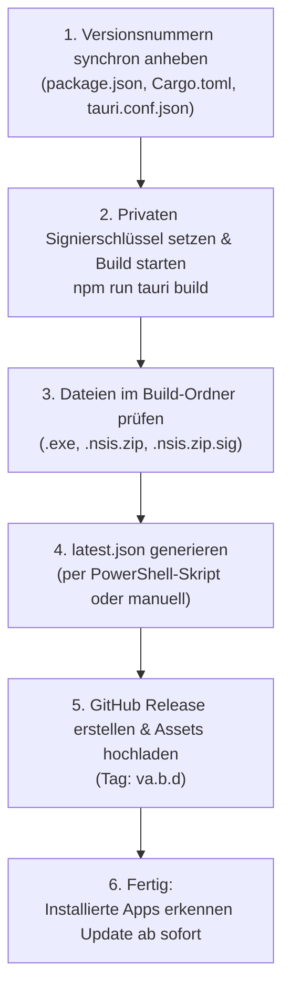

# HowTo: Versionsupdates erstellen und veröffentlichen (LineageGraph)

Diese Anleitung beschreibt Schritt für Schritt, wie Sie für **LineageGraph** ein neues signiertes Update erstellen, das Update-Manifest erzeugen und das Release auf GitHub bereitstellen, sodass alle installierten Instanzen sich automatisch aktualisieren können.

---

## Übersicht des Release-Zyklus



---

## Vorbereitung & Voraussetzungen

* **Speicherort des privaten Schlüssels**: 
  `$env:USERPROFILE\.tauri\lineagegraph.key` (bereits auf Ihrem Entwicklungsrechner vorhanden).
* **Ziel-Repository auf GitHub**: 
  `https://github.com/david-whitney/LineageGraph`

> [!IMPORTANT]
> Geben Sie die Datei `lineagegraph.key` niemals weiter und committen Sie sie unter keinen Umständen in das Git-Repository. Nur mit diesem privaten Schlüssel erzeugte Updates werden von den installierten Programmen akzeptiert.

---

## Schritt 1: Versionsnummer anheben

Erhöhen Sie die Version (Beispiel: von `a.b.c` auf `a.b.d` oder `0.2.0` auf `0.2.1`) in **allen drei Dateien** synchron:

1. **`package.json`**:
   ```json
   "version": "a.b.d",
   ```
2. **`src-tauri/Cargo.toml`**:
   ```toml
   [package]
   name = "lineagegraph"
   version = "a.b.d"
   ```
3. **`src-tauri/tauri.conf.json`**:
   ```json
   "productName": "LineageGraph",
   "version": "a.b.d",
   ```

*Optional:* Committen Sie diesen Versionssprung in Git:
```powershell
git add package.json src-tauri/Cargo.toml src-tauri/tauri.conf.json
git commit -m "chore: bump version to a.b.d"
```

---

## Schritt 2: Signierten Build erstellen

Öffnen Sie ein PowerShell-Terminal im Projektverzeichnis `C:\dev\Froning\app\LineageGraph` und führen Sie folgende Befehle aus:

```powershell
# 1. Pfad zum privaten Schlüssel als Umgebungsvariable deklarieren
$env:TAURI_SIGNING_PRIVATE_KEY_PATH = "$env:USERPROFILE\.tauri\lineagegraph.key"

# 2. Produktions-Build und Signierung starten
npm run tauri build
```

> [!NOTE]
> Tauri baut das Frontend (`npm run build`), kompiliert das Rust-Backend im Release-Modus (`--release`), packt den NSIS-Installer und signiert anschließend das Update-Archiv mit Ihrem hinterlegten Schlüssel.

---

## Schritt 3: Die erzeugten Dateien prüfen

Nach erfolgreichem Build finden Sie die Ergebnisse im Verzeichnis:
`src-tauri\target\release\bundle\nsis\`

Dort liegen die wesentlichen Release-Dateien:
1. `LineageGraph_a.b.d_x64-setup.exe` *(Das Installations- und Updatepaket)*
2. `LineageGraph_a.b.d_x64-setup.exe.sig` *(Die kryptografische Minisign-Signatur)*
3. `latest.json` *(Das Update-Manifest für die App)*

---

## Schritt 4: `latest.json` Manifest erzeugen

Das Manifest `latest.json` teilt installierten Apps mit, welche Version aktuell ist, wo das Update heruntergeladen werden kann und welche Signatur erwartet wird.

### Automatisierte Erstellung via PowerShell (Empfohlen)

Kopieren Sie dieses Snippet in Ihr PowerShell-Terminal (ersetzen Sie bei Bedarf die Versionsnummer und Release-Notes):

```powershell
$version = "a.b.d"
$notes   = "Fehlerbehebungen und Verbesserungen im Stammbaum-Canvas."
$repo    = "david-whitney/LineageGraph"

$sigPath = "src-tauri\target\release\bundle\nsis\LineageGraph_${version}_x64.nsis.zip.sig"
$sig = (Get-Content $sigPath -Raw).Trim()
$pubDate = (Get-Date).ToUniversalTime().ToString("yyyy-MM-ddTHH:mm:ssZ")

$manifest = @{
    version   = $version
    notes     = $notes
    pub_date  = $pubDate
    platforms = @{
        "windows-x86_64" = @{
            signature = $sig
            url       = "https://github.com/$repo/releases/download/v$version/LineageGraph_${version}_x64.nsis.zip"
        }
    }
}

$manifestJson = $manifest | ConvertTo-Json -Depth 4
Set-Content -Path "src-tauri\target\release\bundle\nsis\latest.json" -Value $manifestJson -Encoding utf8
Write-Host "✓ latest.json erfolgreich erzeugt!" -ForegroundColor Green
```

### Aufbau der resultierenden `latest.json` (Zur Kontrolle):
```json
{
  "version": "a.b.d",
  "notes": "Fehlerbehebungen und Verbesserungen im Stammbaum-Canvas.",
  "pub_date": "2026-11-05T15:30:00Z",
  "platforms": {
    "windows-x86_64": {
      "signature": "<signature string>",
      "url": "https://github.com/david-whitney/LineageGraph/releases/download/v<version>/LineageGraph_<version>_x64.nsis.zip"
    }
  }
}
```

---

## Schritt 5: GitHub Release veröffentlichen

1. Öffnen Sie Ihr GitHub-Repository:  
   `https://github.com/david-whitney/LineageGraph/releases`
2. Klicken Sie auf **"Draft a new release"** (Neues Release erstellen).
3. Füllen Sie die Felder aus:
   * **Tag**: Wählen Sie `Create new tag: v<a.b.d>` (mit vorangestelltem `v`).
   * **Release title**: `LineageGraph v<a.b.d>`
   * **Description**: Kurze Beschreibung der Neuerungen/Fixes eingeben.
4. Ziehen Sie folgende **3 Dateien** aus `src-tauri\target\release\bundle\nsis\` in das Upload-Feld:
   * `LineageGraph_<a.b.d>_x64-setup.exe`
   * `LineageGraph_<a.b.d>_x64-setup.exe.sig`
   * `latest.json`
5. Klicken Sie auf **"Publish release"**.

---

## Schritt 6: Was passiert nun auf den Zielgeräten?

Sobald das Release online ist:
1. Jede laufende oder neu gestartete Version `<a.b.d>` fragt die URL:  
   `https://github.com/david-whitney/LineageGraph/releases/latest/download/latest.json` ab.
2. Sie erkennt, dass `<a.b.d>` > `<a.b.c>` ist.
3. Die App lädt `LineageGraph_<a.b.d>_x64.nsis.zip` herunter.
4. Sie prüft die Signatur gegen den in `tauri.conf.json` hinterlegten öffentlichen Schlüssel.
5. Nach Bestätigung/Neustart ist Version `<a.b.d>` installiert.
6. Alle Datenbanken in `%APPDATA%\com.david-whitney.lineagegraph` bleiben unverändert erhalten.
