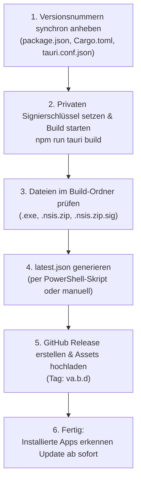

# HowTo: Versionsupdates erstellen und veröffentlichen (LineageGraph)

Diese Anleitung beschreibt Schritt für Schritt, wie Sie für **LineageGraph** ein neues signiertes Update erstellen, das Update-Manifest erzeugen und das Release auf GitHub bereitstellen, sodass alle installierten Instanzen sich automatisch aktualisieren können.

---

## Übersicht des Release-Zyklus



---

## Vorbereitung & Voraussetzungen

* **Speicherort des privaten Schlüssels**: 
  `$env:USERPROFILE\.tauri\lineagegraph.key` (bereits auf Ihrem Entwicklungsrechner vorhanden).
* **Ziel-Repository auf GitHub**: 
  `https://github.com/dryanwhitney-hub/LineageGraph`

> [!WARNING]
> **Wichtiger Hinweis zu privaten Repositories:**
> Releases auf privaten GitHub-Repositories sind für unauthentifizierte Anfragen **nicht** öffentlich erreichbar (GitHub antwortet mit `404 Not Found`). Damit installierte Instanzen von LineageGraph die `latest.json` und Update-Pakete ohne geheime GitHub-Zugriffstoken abrufen können, gibt es zwei gängige Wege:
> 1. **Repository auf "Public" stellen (Empfohlen):** Wenn der Code öffentlich sein darf, stellen Sie das Repository in den GitHub-Settings auf *Public*. Dadurch funktioniert der direkte Download-Link für jeden Anwender sofort und kostenlos.
> 2. **Code privat lassen, Updates öffentlich hosten:** Der Quellcode bleibt im privaten Repository `dryanwhitney-hub/LineageGraph`. Die fertig gebauten Release-Dateien (`latest.json`, `.exe`, `.sig`) werden auf einem öffentlich erreichbaren Speicherort (z. B. ein separates öffentliches GitHub-Repository `LineageGraph-releases` oder Cloudflare R2 / AWS S3) bereitgestellt.

> [!IMPORTANT]
> Geben Sie die Datei `lineagegraph.key` niemals weiter und committen Sie sie unter keinen Umständen in das Git-Repository. Nur mit diesem privaten Schlüssel erzeugte Updates werden von den installierten Programmen akzeptiert.

---

## Schritt 1: Versionsnummer anheben

Erhöhen Sie die Version (Beispiel: von `a.b.c` auf `a.b.d` oder `0.2.0` auf `0.2.1`) in **allen drei Dateien** synchron:

1. **`package.json`**:
   ```json
   "version": "a.b.d",
   ```
2. **`src-tauri/Cargo.toml`**:
   ```toml
   [package]
   name = "lineagegraph"
   version = "a.b.d"
   ```
3. **`src-tauri/tauri.conf.json`**:
   ```json
   "productName": "LineageGraph",
   "version": "a.b.d",
   ```

*Optional:* Committen Sie diesen Versionssprung in Git:
```powershell
git add package.json src-tauri/Cargo.toml src-tauri/tauri.conf.json
git commit -m "chore: bump version to a.b.d"
```

---

## Schritt 2: Signierten Build erstellen

Öffnen Sie ein PowerShell-Terminal im Projektverzeichnis `C:\dev\Froning\app\LineageGraph` und führen Sie folgende Befehle aus:

```powershell
# 1. Pfad zum privaten Schlüssel als Umgebungsvariable deklarieren
$env:TAURI_SIGNING_PRIVATE_KEY_PATH = "$env:USERPROFILE\.tauri\lineagegraph.key"

# 2. Produktions-Build und Signierung starten
npm run tauri build
```

> [!NOTE]
> Tauri baut das Frontend (`npm run build`), kompiliert das Rust-Backend im Release-Modus (`--release`), packt den NSIS-Installer und signiert anschließend das Update-Archiv mit Ihrem hinterlegten Schlüssel.

---

## Schritt 3: Die erzeugten Dateien prüfen

Nach erfolgreichem Build finden Sie die Ergebnisse im Verzeichnis:
`src-tauri\target\release\bundle\nsis\`

Dort liegen die wesentlichen Release-Dateien:
1. `LineageGraph_a.b.d_x64-setup.exe` *(Das Installations- und Updatepaket)*
2. `LineageGraph_a.b.d_x64-setup.exe.sig` *(Die kryptografische Minisign-Signatur)*
3. `latest.json` *(Das Update-Manifest für die App)*

---

## Schritt 4: `latest.json` Manifest erzeugen

Das Manifest `latest.json` teilt installierten Apps mit, welche Version aktuell ist, wo das Update heruntergeladen werden kann und welche Signatur erwartet wird.

### Automatisierte Erstellung via PowerShell (Empfohlen)

Kopieren Sie dieses Snippet in Ihr PowerShell-Terminal (ersetzen Sie bei Bedarf die Versionsnummer und Release-Notes):

```powershell
$version = "0.2.3"
$notes   = "Fehlerbehebungen und Verbesserungen im Stammbaum-Canvas."
$repo    = "dryanwhitney-hub/LineageGraph"

$sigPath = "src-tauri\target\release\bundle\nsis\LineageGraph_${version}_x64-setup.exe.sig"
$sig = (Get-Content $sigPath -Raw).Trim()
$pubDate = (Get-Date).ToUniversalTime().ToString("yyyy-MM-ddTHH:mm:ssZ")

$manifest = @{
    version   = $version
    notes     = $notes
    pub_date  = $pubDate
    platforms = @{
        "windows-x86_64" = @{
            signature = $sig
            url       = "https://github.com/$repo/releases/download/v$version/LineageGraph_${version}_x64-setup.exe"
        }
    }
}

$manifestJson = $manifest | ConvertTo-Json -Depth 4
# UTF-8 OHNE BOM schreiben, da serverseitige JSON-Parser (serde_json) sonst mit 'error decoding response body' abbrechen
$targetPath = "$PSScriptRoot\src-tauri\target\release\bundle\nsis\latest.json"
if (-not (Test-Path "src-tauri")) { $targetPath = "src-tauri\target\release\bundle\nsis\latest.json" }
[System.IO.File]::WriteAllText((Resolve-Path $targetPath), $manifestJson, (New-Object System.Text.UTF8Encoding($false)))
Write-Host "✓ latest.json erfolgreich erzeugt (UTF-8 ohne BOM)!" -ForegroundColor Green
```

### Aufbau der resultierenden `latest.json` (Zur Kontrolle):
```json
{
  "version": "a.b.d",
  "notes": "Fehlerbehebungen und Verbesserungen im Stammbaum-Canvas.",
  "pub_date": "2026-11-05T15:30:00Z",
  "platforms": {
    "windows-x86_64": {
      "signature": "<signature string>",
      "url": "https://github.com/dryanwhitney-hub/LineageGraph/releases/download/v<version>/LineageGraph_<version>_x64.nsis.zip"
    }
  }
}
```

---

## Schritt 5: GitHub Release veröffentlichen

1. Öffnen Sie Ihr GitHub-Repository:  
   `https://github.com/dryanwhitney-hub/LineageGraph/releases`
2. Klicken Sie auf **"Draft a new release"** (Neues Release erstellen).
3. Füllen Sie die Felder aus:
   * **Tag**: Wählen Sie `Create new tag: v<a.b.d>` (mit vorangestelltem `v`).
   * **Release title**: `LineageGraph v<a.b.d>`
   * **Description**: Kurze Beschreibung der Neuerungen/Fixes eingeben.
4. Ziehen Sie folgende **3 Dateien** aus `src-tauri\target\release\bundle\nsis\` in das Upload-Feld:
   * `LineageGraph_<a.b.d>_x64-setup.exe`
   * `LineageGraph_<a.b.d>_x64-setup.exe.sig`
   * `latest.json`
5. **Release-Optionen prüfen:**
   * Stellen Sie sicher, dass **"Set as the latest release"** ausgewählt ist.
   * Das Kontrollkästchen **"Set as a pre-release"** darf **nicht** aktiviert sein (GitHubs `/releases/latest`-Endpunkt ignoriert Pre-Releases).
6. Klicken Sie auf **"Publish release"** (bzw. bei bestehendem Pre-Release auf **"Update release"**).

---

## Schritt 6: Was passiert nun auf den Zielgeräten?

Sobald das Release online ist:
1. Jede laufende oder neu gestartete Version `<a.b.c>` fragt die URL:  
   `https://github.com/dryanwhitney-hub/LineageGraph/releases/latest/download/latest.json` ab.
2. Sie erkennt, dass `<a.b.d>` > `<a.b.c>` ist.
3. Die App lädt `LineageGraph_<a.b.d>_x64-setup.exe` im Hintergrund herunter.
4. Sie prüft die Signatur gegen den in `tauri.conf.json` hinterlegten öffentlichen Schlüssel.
5. Nach Bestätigung/Neustart ist Version `<a.b.d>` installiert.
6. Alle SQLite-Datenbanken in `%APPDATA%\com.david-whitney.lineagegraph` bleiben unverändert erhalten.

---

## Besonderheit: Änderungen am Datenbank-Schema (Migrationen)

Bei einem App-Update werden ausschließlich die Programmdateien (Binaries) ausgetauscht. Die SQLite-Datenbanken der Anwender (`<baum>.db` in `%APPDATA%\com.david-whitney.lineagegraph`) verbleiben unverändert auf dem System.

Bringt eine neue Version strukturelle Datenbankänderungen mit, muss die Anwendung diese beim ersten Öffnen der bestehenden Datenbank **automatisch und abwärtskompatibel** anwenden.

### Wo finden Datenbank-Änderungen statt?
In [`src-tauri/src/db.rs`](src-tauri/src/db.rs) in der Funktion `setup_schema(conn: Connection)`. Diese Funktion wird bei jedem Öffnen eines Stammbaums (`init_database`) aufgerufen.

---

### Typische Szenarien und deren Umsetzung

#### Szenario 1: Neue Tabelle oder neuer Index (Einfach)
Verwenden Sie stets `CREATE TABLE IF NOT EXISTS` bzw. `CREATE INDEX IF NOT EXISTS`. Bestehende Datenbanken legen die neue Tabelle beim Start einfach an; existiert sie bereits, passiert nichts:

```sql
CREATE TABLE IF NOT EXISTS notes (
    id TEXT PRIMARY KEY,
    person_id TEXT NOT NULL,
    content TEXT NOT NULL,
    FOREIGN KEY(person_id) REFERENCES individuals(id) ON DELETE CASCADE
);
CREATE INDEX IF NOT EXISTS idx_notes_person ON notes(person_id);
```

#### Szenario 2: Neue Spalte zu bestehender Tabelle hinzufügen (Häufig)
Da SQLite kein bedingtes `ADD COLUMN IF NOT EXISTS` unterstützt, wird das Schema dynamisch per `PRAGMA table_info` geprüft (bereits als Standardmuster in `src-tauri/src/db.rs` etabliert):

```rust
// Spalten der Tabelle abfragen
let columns: Vec<String> = {
    let mut stmt = conn.prepare("PRAGMA table_info(individuals)")?;
    let rows = stmt.query_map([], |row| row.get::<_, String>(1))?;
    rows.filter_map(Result::ok).collect()
};

// Falls die Spalte noch nicht existiert -> hinzufügen
if !columns.contains(&"email".to_string()) {
    conn.execute("ALTER TABLE individuals ADD COLUMN email TEXT", [])?;
}
```

> [!TIP]
> Vergeben Sie bei `ADD COLUMN` für `NOT NULL`-Spalten immer einen `DEFAULT`-Wert (z. B. `DEFAULT ''` oder `DEFAULT 0`), da bestehende Datensätze sonst die Bedingung verletzen würden.

#### Szenario 3: Spalte umbenennen, Typ ändern oder Spalte entfernen (Komplex)
SQLite unterstützt bis Version 3.35 kein `DROP COLUMN` und nur eingeschränktes `ALTER TABLE`. Das empfohlene SQLite-Muster ist die **Table Recreation (Tabellen-Neuerstellung)** innerhalb einer Transaktion:

```rust
conn.execute_batch("
    BEGIN TRANSACTION;

    -- 1. Neue Tabelle mit der gewünschten Zielstruktur erstellen
    CREATE TABLE individuals_new (
        id TEXT PRIMARY KEY,
        xref_id TEXT NOT NULL,
        full_name TEXT, -- Zusammengeführtes Namensfeld
        sex TEXT,
        json_data TEXT NOT NULL
    );

    -- 2. Daten aus alter Tabelle transformiert übernehmen
    INSERT INTO individuals_new (id, xref_id, full_name, sex, json_data)
    SELECT id, xref_id, TRIM(COALESCE(given_name, '') || ' ' || COALESCE(surname, '')), sex, json_data
    FROM individuals;

    -- 3. Alte Tabelle verwerfen
    DROP TABLE individuals;

    -- 4. Neue Tabelle umbenennen
    ALTER TABLE individuals_new RENAME TO individuals;

    -- 5. Indizes neu anlegen
    CREATE INDEX IF NOT EXISTS idx_individuals_xref ON individuals(xref_id);

    COMMIT;
")?;
```

---

### Best Practices für schemaverändernde Releases

1. **Automatisches Sicherheits-Backup vor Migrationen**:
   Bei größeren Eingriffen sollte vor dem ersten `setup_schema` eine Sicherungskopie der `.db`-Datei angelegt werden:
   ```rust
   let backup_path = db_path.with_extension("db.backup_pre_migration");
   if !backup_path.exists() {
       let _ = std::fs::copy(db_path, backup_path);
   }
   ```
2. **Versionssprünge bedenken (Sequentialität)**:
   Ein Anwender könnte Version `0.2.0` nutzen und erst bei Version `0.5.0` wieder aktualisieren. Alle Migrationen müssen so geschrieben sein, dass sie auch nacheinander auf einer sehr alten Datenbank fehlerfrei durchlaufen.
3. **Lokaler Test vor Veröffentlichung**:
   Kopieren Sie vor dem Release eine Test-Datenbank einer älteren Version (z. B. aus einem Backup) in das AppData-Verzeichnis und prüfen Sie mit `npm run tauri dev`, ob die Migration sauber greift und alle Personen/Beziehungen intakt bleiben.
