# Fachliches Anforderungsdokument (Requirements Specification - REQ)

**System:** LineageGraph (Froning Familienbuch)  
**Dokument-Version:** 3.0.0  
**Status:** Freigegebener Ist-Stand  
**Datum:** 5. November 2026  
**Referenzierte Dokumente:** [SPEC.md](file:///c:/dev/Froning/app/LineageGraph/SPEC.md), [Architecture.md](file:///c:/dev/Froning/app/LineageGraph/Architecture.md)

---

## 1. Einleitung & Zielsetzung

Dieses Dokument definiert alle fachlichen Anforderungen an das System **LineageGraph** (*stammbaum*). Es beschreibt den Funktionsumfang, den geschäftlichen Nutzen (Business Value) sowie die verbindlichen Akzeptanzkriterien und Geschäftsregeln.

```mermaid
graph TD
    classDef req fill:#e1f5fe,stroke:#0288d1,stroke-width:1.5px,color:#01579b;
    classDef cat fill:#f3e5f5,stroke:#7b1fa2,stroke-width:2px,color:#4a148c;

    CAT_TRM["1. Stammbaum-Verwaltung (TRM)"]:::cat
    CAT_DAT["2. Personen- & Beziehungsdaten (DAT)"]:::cat
    CAT_ALG["3. Genealogische Algorithmen (ALG)"]:::cat
    CAT_UI["4. Benutzeroberfläche & Views (UI)"]:::cat
    CAT_DSG["5. Design-Studio & Layout (DSG)"]:::cat
    CAT_IMP["6. Import & Merge-System (IMP)"]:::cat
    CAT_EXP["7. Export & Publikation (EXP)"]:::cat

    CAT_TRM --> REQ_TRM_001["REQ-TRM-001: Multi-Stammbaum-Verwaltung"]:::req
    CAT_TRM --> REQ_TRM_002["REQ-TRM-002: 2-Stufen-Sicherheitslöschung"]:::req
    CAT_TRM --> REQ_TRM_003["REQ-TRM-003: Leerzustand & Fallback"]:::req

    CAT_DAT --> REQ_DAT_001["REQ-DAT-001: Personen-Erfassung & XREF-Gen"]:::req
    CAT_DAT --> REQ_DAT_002["REQ-DAT-002: Batch-Editierung & Validierung"]:::req
    CAT_DAT --> REQ_DAT_003["REQ-DAT-003: Eltern-Kind & Rekursionsprüfung"]:::req
    CAT_DAT --> REQ_DAT_004["REQ-DAT-004: Ehe- & Partnerschafts-Lifecycle"]:::req
    CAT_DAT --> REQ_DAT_005["REQ-DAT-005: Audit-Felder (CHAN / UID)"]:::req

    CAT_ALG --> REQ_ALG_001["REQ-ALG-001: Multi-Probanden-Verwaltung"]:::req
    CAT_ALG --> REQ_ALG_002["REQ-ALG-002: Henry-Code-Berechnung"]:::req
    CAT_ALG --> REQ_ALG_003["REQ-ALG-003: Kürzester Beziehungspfad (A*)"]:::req

    CAT_UI --> REQ_UI_001["REQ-UI-001: Interaktive Daten-Tabelle"]:::req
    CAT_UI --> REQ_UI_002["REQ-UI-002: Infinite-Canvas-Stammbaum"]:::req
    CAT_UI --> REQ_UI_003["REQ-UI-003: Detail-Drawer & Verwandtschafts-Inspector"]:::req
    CAT_UI --> REQ_UI_004["REQ-UI-004: Freie Schnellabfrage (Free Query)"]:::req
    CAT_UI --> REQ_UI_005["REQ-UI-005: Zweisprachigkeit (DE / EN)"]:::req

    CAT_DSG --> REQ_DSG_001["REQ-DSG-001: Automatisches Pedigree-Layout"]:::req
    CAT_DSG --> REQ_DSG_002["REQ-DSG-002: Orthogonale Linienbrücken"]:::req
    CAT_DSG --> REQ_DSG_003["REQ-DSG-003: Customizing von Personenkarten"]:::req
    CAT_DSG --> REQ_DSG_004["REQ-DSG-004: Hintergrundgestaltung & Bild-Persistenz"]:::req
    CAT_DSG --> REQ_DSG_005["REQ-DSG-005: Layout-Historie & Undo/Redo"]:::req

    CAT_IMP --> REQ_IMP_001["REQ-IMP-001: Atomarer GEDCOM-Vollimport"]:::req
    CAT_IMP --> REQ_IMP_002["REQ-IMP-002: GEDCOM-Staging & Matching"]:::req
    CAT_IMP --> REQ_IMP_003["REQ-IMP-003: Differentieller 3-Wege-Merge"]:::req

    CAT_EXP --> REQ_EXP_001["REQ-EXP-001: GEDCOM-Teilmengen-Export"]:::req
    CAT_EXP --> REQ_EXP_002["REQ-EXP-002: Strukturierter CSV-Export"]:::req
    CAT_EXP --> REQ_EXP_003["REQ-EXP-003: Autarke HTML-Chronik"]:::req
    CAT_EXP --> REQ_EXP_004["REQ-EXP-004: Hochauflösender Bild-/Vektorexport"]:::req
    CAT_EXP --> REQ_EXP_005["REQ-EXP-005: LaTeX/TikZ-Buchchronik"]:::req
```

Jede Anforderung besitzt eine eindeutige Kennung (`REQ-<DOMÄNE>-<NR>`), die lückenlos in der technischen Spezifikation ([SPEC.md](file:///c:/dev/Froning/app/LineageGraph/SPEC.md)) und der Traceability-Matrix ([Architecture.md](file:///c:/dev/Froning/app/LineageGraph/Architecture.md)) referenziert wird.

---

## 2. Fachliche Anforderungen nach Domänen

### 2.1 Stammbaum- & Workspace-Verwaltung (TRM)

#### REQ-TRM-001: Multi-Stammbaum-Verwaltung & Umschaltung
- **Titel & Kurzbeschreibung:** Verwaltung voneinander vollständig isolierter Stammbäume mit nahtlosem Wechsel im laufenden Betrieb.
- **Fachlicher Zweck / Business Value:** Ermöglicht Genealogen die parallele Bearbeitung verschiedener Familienlinien oder Forschungsstände ohne Vermischung von Datensätzen.
- **Akzeptanzkriterien & Geschäftsregeln:**
  1. Alle Stammbäume müssen als eigenständige `.db`-Dateien im anwendungseigenen Verzeichnis abgelegt werden.
  2. Die Benutzeroberfläche muss eine Auswahlliste aller verfügbaren Stammbäume anbieten.
  3. Beim Wechsel des aktiven Stammbaums muss der SQLite-Verbindungspool im Backend transparent umgehängt werden, ohne dass die Desktop-Applikation neu gestartet werden muss.
  4. Nach dem Umschalten müssen alle Frontend-Zustände (Personenliste, Probanden, Filter, Historie) synchron aktualisiert werden.
- **Technische Spezifikation:** Siehe [SPEC-TRM-001 in SPEC.md](file:///c:/dev/Froning/app/LineageGraph/SPEC.md#spec-trm-001---req-trm-001)

#### REQ-TRM-002: Zweistufige Sicherheitslöschung mit Prozess-Schutz
- **Titel & Kurzbeschreibung:** Physisches, rückstandsfreies Löschen eines Stammbaums mit zweistufiger Sicherheitsabfrage und Betriebssystem-Sperrschutz.
- **Fachlicher Zweck / Business Value:** Verhindert katastrophalen Datenverlust durch versehentliche Klicks und garantiert die saubere Dateifreigabe unter Windows.
- **Akzeptanzkriterien & Geschäftsregeln:**
  1. Das Löschen erfordert zwei aufeinanderfolgende modale Bestätigungsschritte.
  2. Im Dialog muss der "Abbrechen"-Button optisch priorisiert gerendert werden und standardmäßig den Tastaturfokus besitzen (Autofokus).
  3. Vor dem Entfernen muss die aktive SQLite-Verbindung geflusht (WAL-Checkpoint), geschlossen und auf eine In-Memory-Instanz umgeleitet werden, um Windows-Filelocks (`ERROR_SHARING_VIOLATION`) aufzuheben.
  4. Alle zugehörigen Dateiartefakte (`.db`, `.db-wal`, `.db-shm`, `.db-journal`, `.sqlite*`) müssen physisch gelöscht werden; bei Sperrung greift eine Retry-Schleife mit exponentiellem Backoff.
  5. Andere Stammbäume dürfen unter keinen Umständen tangiert werden.
- **Technische Spezifikation:** Siehe [SPEC-TRM-002 in SPEC.md](file:///c:/dev/Froning/app/LineageGraph/SPEC.md#spec-trm-002---req-trm-002)

#### REQ-TRM-003: Automatischer Fallback & Leerzustands-Behandlung
- **Titel & Kurzbeschreibung:** Zustandshandling beim Löschen des letzten aktiven Stammbaums sowie Neuanlage beim GEDCOM-Import.
- **Fachlicher Zweck / Business Value:** Schützt die Anwendungsstabilität vor Null-Pointer-Zuständen und führt den Benutzer geführt durch die Neuerstellung.
- **Akzeptanzkriterien & Geschäftsregeln:**
  1. Verbleiben nach einem Löschvorgang weitere Stammbäume, wird automatisch der lexikografisch nächste geöffnet.
  2. War der gelöschte Stammbaum der letzte, wechselt die Anwendung in einen konsistenten Leerzustand: `activeTree = ''`, Deaktivierung des Lösch-Buttons, Anzeige von Hinweisen.
  3. Erfolgt ein GEDCOM-Import im Leerzustand, muss automatisch ein neuer Stammbaum basierend auf dem Dateinamen erzeugt werden.
- **Technische Spezifikation:** Siehe [SPEC-TRM-003 in SPEC.md](file:///c:/dev/Froning/app/LineageGraph/SPEC.md#spec-trm-003---req-trm-003)

---

### 2.2 Personen- & Beziehungsstammdaten (DAT)

#### REQ-DAT-001: Personen-Erfassung & Inkrementelle XREF-Generierung
- **Titel & Kurzbeschreibung:** Neuanlage von Einzelpersonen (unabhängig oder verknüpft) mit automatischer Vergabe eindeutiger GEDCOM-konformer XREF-Bezeichner.
- **Fachlicher Zweck / Business Value:** Gewährleistet lückenlose Normierung und Kompatibilität mit dem GEDCOM-Standard ohne manuelle ID-Kollisionsprüfungen.
- **Akzeptanzkriterien & Geschäftsregeln:**
  1. Unterstützt Anlage als Einzelperson, Kind eines Paares, Elternteil oder Partner einer Person.
  2. Die neue ID wird über das Backend als höchste existierende numerische Folge im Format `@I<Nr>@` (z. B. `I1`, `I245`) ermittelt.
  3. Erfassung von Vorname, Nachname, Geschlecht (`M`, `F`, `U`), Geburtsdatum, Geburtsort, Sterbedatum und Sterbeort.
- **Technische Spezifikation:** Siehe [SPEC-DAT-001 in SPEC.md](file:///c:/dev/Froning/app/LineageGraph/SPEC.md#spec-dat-001---req-dat-001)

#### REQ-DAT-002: Tabellarische Batch-Editierung & Validierungs-Engine
- **Titel & Kurzbeschreibung:** Direkte Inline-Bearbeitung von Personendaten im Tabellenmodus mit Validierungsprüfung und atomarer Speicherung.
- **Fachlicher Zweck / Business Value:** Ermöglicht Massenkorrekturen und rasche Datenpflege bei großen Genealogie-Beständen mit sofortiger Fehleranzeige.
- **Akzeptanzkriterien & Geschäftsregeln:**
  1. Modifizierte Zellen werden im Frontend als Arbeitsentwurf gepuffert.
  2. IDs müssen zwingend valide GEDCOM-XREFs sein (Regex: `^@?[A-Za-z0-9_:-]+@?$`).
  3. Bei ID-Änderung werden alle relationalen Fremdschlüssel (`families`, `parent_child`, `events`, `root_ancestors`, `proband_henry_codes`, `design_layouts`) konsistent kaskadierend umbenannt.
  4. Die Speicherung aller Änderungen erfolgt atomar in einer einzigen Datenbanktransaktion.
- **Technische Spezifikation:** Siehe [SPEC-DAT-002 in SPEC.md](file:///c:/dev/Froning/app/LineageGraph/SPEC.md#spec-dat-002---req-dat-002)

#### REQ-DAT-003: Eltern-Kind-Verknüpfung mit Zyklus- & Rekursionserkennung
- **Titel & Kurzbeschreibung:** Zuweisung und Modifikation von Vater und Mutter mit Vorab-Prüfung gegen genealogische Schleifen.
- **Fachlicher Zweck / Business Value:** Schützt die Datenbankintegrität vor biologisch und logisch unmöglichen Zyklen (z. B. eine Person wird ihr eigener Großelternteil).
- **Akzeptanzkriterien & Geschäftsregeln:**
  1. Vor dem Speichern prüft eine Tiefen- oder Breitensuche, ob das Kind bereits in der Ahnenlinie des vorgeschlagenen Elternteils existiert.
  2. Selbstreferenzen (`Kind == Elternteil`) werden sofort abgewiesen.
  3. Bei Erkennung einer Rekursion wird die Operation mit einer Fehlermeldung abgebrochen und die Datenbank verbleibt unverändert.
  4. Nach erfolgreicher Modifikation werden die Henry-Codes aller aktiven Probanden automatisch neu berechnet.
- **Technische Spezifikation:** Siehe [SPEC-DAT-003 in SPEC.md](file:///c:/dev/Froning/app/LineageGraph/SPEC.md#spec-dat-003---req-dat-003)

#### REQ-DAT-004: Partnerschafts- und Ehedaten-Management
- **Titel & Kurzbeschreibung:** Verknüpfung, Bearbeitung und Auflösung von Ehen und Lebenspartnerschaften inklusive Scheidungsstatus.
- **Fachlicher Zweck / Business Value:** Vollständige Abbildung komplexer Familienverhältnisse über mehrere Generationen und Zweige.
- **Akzeptanzkriterien & Geschäftsregeln:**
  1. Zu jeder Partnerverbindung können Heiratsdatum, Scheidungsdatum und ein explizites Scheidungsflag hinterlegt werden.
  2. Partner können interaktiv neu miteinander verknüpft werden; dabei wird ein neuer Familiendatensatz angelegt.
  3. Eine Familie kann aufgelöst werden (`unlink_family`), wodurch die Partner-Verknüpfung gelöscht wird, während die Personen erhalten bleiben.
  4. Kinder können direkt zu einer Familie hinzugefügt oder entfernt werden.
- **Technische Spezifikation:** Siehe [SPEC-DAT-004 in SPEC.md](file:///c:/dev/Froning/app/LineageGraph/SPEC.md#spec-dat-004---req-dat-004)

#### REQ-DAT-005: Audit- & Revisionsfelder (GEDCOM CHAN / UID)
- **Titel & Kurzbeschreibung:** Automatische Nachführung von Änderungszeitstempeln und eindeutigen Identifikatoren bei Modifikationen.
- **Fachlicher Zweck / Business Value:** Revisionssicherheit und Synchronisierbarkeit bei anschließendem GEDCOM-Export.
- **Akzeptanzkriterien & Geschäftsregeln:**
  1. Bei Neuanlage einer Person ohne UID wird automatisch eine UUID v4 im Feld `_UID` persistiert.
  2. Jede Bearbeitung aktualisiert das Tag `CHAN` mit aktuellem Datum und Uhrzeit im Format `DD MMM YYYY / HH:MM:SS`.
- **Technische Spezifikation:** Siehe [SPEC-DAT-005 in SPEC.md](file:///c:/dev/Froning/app/LineageGraph/SPEC.md#spec-dat-005---req-dat-005)

---

### 2.3 Genealogische Berechnungen & Algorithmen (ALG)

#### REQ-ALG-001: Multi-Probanden-Verwaltung (Multi-Root)
- **Titel & Kurzbeschreibung:** Parallele Definition mehrerer Stammahnen (Probanden) mit individuellen Start-Codes.
- **Fachlicher Zweck / Business Value:** Ermöglicht die zeitgleiche Auswertung verschiedener Familienzweige innerhalb eines einzigen Stammbaums.
- **Akzeptanzkriterien & Geschäftsregeln:**
  1. Beliebig viele Personen können als Stammahn in `root_ancestors` deklariert werden.
  2. Jeder Proband besitzt ein frei wählbares Startkürzel (z. B. `1`, `2`, `A`, `F-1`).
  3. Die Benutzeroberfläche stellt Probanden als Umschalt-Tabs in der oberen Navigationsleiste dar.
- **Technische Spezifikation:** Siehe [SPEC-ALG-001 in SPEC.md](file:///c:/dev/Froning/app/LineageGraph/SPEC.md#spec-alg-001---req-alg-001)

#### REQ-ALG-002: Chronologische & Patrilineare/Matrilineare Henry-Code-Berechnung
- **Titel & Kurzbeschreibung:** Automatische Vergabe von Henry-Codes entlang der Abstammungslinie mit Zyklenvermeidung und chronologischer Geschwistersortierung.
- **Fachlicher Zweck / Business Value:** Standardisierte genealogische Ordnung zur eindeutigen hierarchischen Kennzeichnung jeder Person im Verhältnis zum Stammahn.
- **Akzeptanzkriterien & Geschäftsregeln:**
  1. Standardmäßig patrilineare Vererbung über den Vater (`husband_id`).
  2. Befindet sich der Vater nicht im Stammbaum oder ist der Proband weiblich, erfolgt matrilinearer Fallback über die Mutter (`wife_id`).
  3. Geschwister innerhalb einer Familie werden chronologisch nach ihrem Geburtsdatum (Jahr, Monat, Tag) sortiert, bevor der Code-Suffix vergeben wird.
  4. Code-Suffixe: Kinder 1–9 erhalten `1`–`9`, Kind 10 erhält `A`, Kind 11 `B` bis Kind 20 `K`; ab 21 `X<Nr>`.
  5. Bereits besuchte Personen werden nicht erneut traversiert (strikter Zyklenschutz).
- **Technische Spezifikation:** Siehe [SPEC-ALG-002 in SPEC.md](file:///c:/dev/Froning/app/LineageGraph/SPEC.md#spec-alg-002---req-alg-002)

#### REQ-ALG-003: Kürzester Verwandtschaftspfad (A*- & BFS-Graphsuche)
- **Titel & Kurzbeschreibung:** Berechnung und Visualisierung des kürzesten Verwandtschaftspfades zwischen zwei beliebigen Personen im Stammbaum.
- **Fachlicher Zweck / Business Value:** Liefert Anwendern den direkten Nachweis, wie zwei Personen miteinander verwandt oder verschwägert sind.
- **Akzeptanzkriterien & Geschäftsregeln:**
  1. Graph-Traversierung über Eltern-, Kind- und optional Partnerbeziehungen.
  2. Backend: A*-Algorithmus über `petgraph` zur deterministischen Pfadberechnung.
  3. Frontend: Breitensuche mit interaktiver Klick-Navigation und farblicher Hervorhebung im Canvas-Stammbaum.
- **Technische Spezifikation:** Siehe [SPEC-ALG-003 in SPEC.md](file:///c:/dev/Froning/app/LineageGraph/SPEC.md#spec-alg-003---req-alg-003)

---

### 2.4 Benutzeroberfläche & Views (UI)

#### REQ-UI-001: Interaktive Datentabelle mit Sortierung & Multi-Filtern
- **Titel & Kurzbeschreibung:** Leistungsfähige Tabellenansicht mit spaltenweiser Text- und Datumsfilterung, Spaltensortierung und anpassbarer Spaltensichtbarkeit.
- **Fachlicher Zweck / Business Value:** Schnelles Auffinden, Vergleichen und Selektieren von Personen aus großen Datenbeständen (> 10.000 Einträge).
- **Akzeptanzkriterien & Geschäftsregeln:**
  1. Spalten für ID, Nachname, Vorname, Geschlecht, Geburtsdatum/-ort, Sterbedatum/-ort, Henry-Code und Generation.
  2. Spalten können in den Einstellungen ein-/ausgeblendet und in ihrer Reihenfolge verschoben werden.
  3. Klick auf Spaltenkopf schaltet zwischen aufsteigender, absteigender und Standard-Sortierung um.
- **Technische Spezifikation:** Siehe [SPEC-UI-001 in SPEC.md](file:///c:/dev/Froning/app/LineageGraph/SPEC.md#spec-ui-001---req-ui-001)

#### REQ-UI-002: Infinite Canvas Stammbaum-Visualisierung
- **Titel & Kurzbeschreibung:** Interaktiver grafischer Stammbaum mit stufenlosem Zoom, Panning und Clusterung von Seitenästen.
- **Fachlicher Zweck / Business Value:** Intuitive visuelle Exploration des Stammbaums von den Ahnen bis zu den Nachkommen.
- **Akzeptanzkriterien & Geschäftsregeln:**
  1. Zoomfaktor von 20 % bis 250 % stufenlos steuerbar via Mausrad oder Kontrollleiste.
  2. Seitenäste (Ehepartner, Eltern) können ein- und ausgeklappt werden.
  3. Schaltfläche zum Nachladen von Eltern an der Baumwurzel sowie Schnell-Zentrierung auf den Stammahn.
- **Technische Spezifikation:** Siehe [SPEC-UI-002 in SPEC.md](file:///c:/dev/Froning/app/LineageGraph/SPEC.md#spec-ui-002---req-ui-002)

#### REQ-UI-003: Slide-Over Detail-Drawer & Verwandtschafts-Inspector
- **Titel & Kurzbeschreibung:** Seitenleiste mit vollständiger Übersicht aller Attribute, Eltern, Geschwister, Partner, Kinder, Notizen und GEDCOM-Rohdaten.
- **Fachlicher Zweck / Business Value:** Schneller Zugriff auf den genealogischen Kontext einer selektierten Person ohne Verlassen der aktuellen Hauptansicht.
- **Akzeptanzkriterien & Geschäftsregeln:**
  1. Schnellsprung durch Klick auf Verwandte (Eltern, Partner, Kinder).
  2. Integrierter Eltern-Editor im Editiermodus.
  3. Anzeige strukturierter GEDCOM-Tags und Freitextnotizen.
- **Technische Spezifikation:** Siehe [SPEC-UI-003 in SPEC.md](file:///c:/dev/Froning/app/LineageGraph/SPEC.md#spec-ui-003---req-ui-003)

#### REQ-UI-004: Freie Schnellabfrage (Free Query Modal)
- **Titel & Kurzbeschreibung:** Tastaturbedienbares Schnell-Suchfenster zur kombinierten Suche nach Name, Vorname, Geburtsdaten und ID.
- **Fachlicher Zweck / Business Value:** Blitzschnelles Navigieren zu einer gesuchten Person im Stammbaum.
- **Akzeptanzkriterien & Geschäftsregeln:**
  1. Live-Filterung während der Eingabe.
  2. Klick auf ein Suchergebnis selektiert die Person und zentriert die Visualisierung.
- **Technische Spezifikation:** Siehe [SPEC-UI-004 in SPEC.md](file:///c:/dev/Froning/app/LineageGraph/SPEC.md#spec-ui-004---req-ui-004)

#### REQ-UI-005: Vollständige Internationalisierung (DE / EN)
- **Titel & Kurzbeschreibung:** Umschaltbare Mehrsprachigkeit für Deutsch und Englisch über alle UI-Elemente und Fehlermeldungen.
- **Fachlicher Zweck / Business Value:** Zugänglichkeit für internationale Forscher und Familienmitglieder.
- **Akzeptanzkriterien & Geschäftsregeln:**
  1. Umschaltung in den Einstellungen mit sofortiger Auswirkung ohne Neuladen.
  2. Vollständige Übersetzung aller Tabellentexte, Dialoge, Badges und Tooltips.
- **Technische Spezifikation:** Siehe [SPEC-UI-005 in SPEC.md](file:///c:/dev/Froning/app/LineageGraph/SPEC.md#spec-ui-005---req-ui-005)

---

### 2.5 Stammbaum Design Studio (DSG)

#### REQ-DSG-001: Automatisches hierarchisches Pedigree-Layout
- **Titel & Kurzbeschreibung:** Berechnung ästhetischer, kollisionsfreier Layouts mit Generationen-Schichten und anpassbaren Abständen.
- **Fachlicher Zweck / Business Value:** Erstellung druckreifer Stammbaum-Diagramme ohne mühsames manuelles Anordnen einzelner Karten.
- **Akzeptanzkriterien & Geschäftsregeln:**
  1. Gruppierung von Geschwistern und Partnern in gemeinsamen horizontalen Bändern.
  2. Automatische Sub-Lane-Berechnung zur Vermeidung von Überlappungen bei dichten Familienzweigen.
  3. Konfigurierbare Mindestabstände zwischen Zweigen und Personen.
- **Technische Spezifikation:** Siehe [SPEC-DSG-001 in SPEC.md](file:///c:/dev/Froning/app/LineageGraph/SPEC.md#spec-dsg-001---req-dsg-001)

#### REQ-DSG-002: Orthogonale Linienführung & Linienbrücken (Line Bridges)
- **Titel & Kurzbeschreibung:** Rechtwinklige SVG-Verbindungslinien mit bogenförmigen Brücken bei Kreuzungen.
- **Fachlicher Zweck / Business Value:** Klare Nachverfolgbarkeit von Abstammungslinien auch in hochgradig vernetzten Stammbäumen.
- **Akzeptanzkriterien & Geschäftsregeln:**
  1. Horizontale und vertikale Segmente verbinden Eltern mit Kindern.
  2. Schneiden sich zwei Linien, überspringt eine Linie die andere mit einem definierten Halbkreis-Bogen (`bridgeRadius`).
  3. Umschaltbare Option zur Minimierung von Brücken.
- **Technische Spezifikation:** Siehe [SPEC-DSG-002 in SPEC.md](file:///c:/dev/Froning/app/LineageGraph/SPEC.md#spec-dsg-002---req-dsg-002)

#### REQ-DSG-003: Voll konfigurierbare Personenkarten
- **Titel & Kurzbeschreibung:** Detaillierte Gestaltung von Kartenbreite, Typografie, Rahmenfarben, Schatten und angezeigten Datenfeldern.
- **Fachlicher Zweck / Business Value:** Anpassung des visuellen Erscheinungsbildes an individuelle Vorlieben oder Publikationsstile.
- **Akzeptanzkriterien & Geschäftsregeln:**
  1. Farben für männliche, weibliche und neutrale Personen getrennt konfigurierbar.
  2. Optionale Einblendung von Geburts-/Sterbedatum, Lebensspanne, Henry-Code und Generation.
- **Technische Spezifikation:** Siehe [SPEC-DSG-003 in SPEC.md](file:///c:/dev/Froning/app/LineageGraph/SPEC.md#spec-dsg-003---req-dsg-003)

#### REQ-DSG-004: Hintergrundgestaltung & Bild-Persistierung
- **Titel & Kurzbeschreibung:** Hinterlegen von Farben, Verläufen oder Wappen/Kartenbildern mit Deckkraft- und Skalierungsregelung.
- **Fachlicher Zweck / Business Value:** Hochwertige optische Untermalung für Familienfeste und Chroniken.
- **Akzeptanzkriterien & Geschäftsregeln:**
  1. Import lokaler Bilddateien (PNG, JPG, SVG).
  2. Dauerhafte Speicherung der Bild-Binärdaten in der SQLite-Datenbank (`design_layouts`).
  3. Frei justierbare Deckkraft (Opacity), Skalierung und Positionierung.
- **Technische Spezifikation:** Siehe [SPEC-DSG-004 in SPEC.md](file:///c:/dev/Froning/app/LineageGraph/SPEC.md#spec-dsg-004---req-dsg-004)

#### REQ-DSG-005: Layout-Persistenz & Undo/Redo-Verlauf
- **Titel & Kurzbeschreibung:** Speichern beliebig vieler benannter Design-Layouts pro Proband sowie lückenlose Rückgängig-Funktion.
- **Fachlicher Zweck / Business Value:** Sicheres Experimentieren mit visuellen Anordnungen ohne Datenverlust.
- **Akzeptanzkriterien & Geschäftsregeln:**
  1. Speichern und Laden von Layouts pro Proband in der Tabelle `design_layouts`.
  2. Undo/Redo-Stack für Verschiebungen, Einklappungen und Stilanpassungen.
- **Technische Spezifikation:** Siehe [SPEC-DSG-005 in SPEC.md](file:///c:/dev/Froning/app/LineageGraph/SPEC.md#spec-dsg-005---req-dsg-005)

---

### 2.6 Import & Differentieller Datenabgleich (IMP)

#### REQ-IMP-001: Atomarer GEDCOM-Vollimport (5.5 / 5.5.1)
- **Titel & Kurzbeschreibung:** Robuster Import ganzer GEDCOM-Dateien mit transaktionalem Ersetzen des Stammbaums.
- **Fachlicher Zweck / Business Value:** Schnelle Migration bestehender Stammbäume aus Drittsoftware (z. B. Ahnenblatt, Ancestry, FamilySearch).
- **Akzeptanzkriterien & Geschäftsregeln:**
  1. Unterstützung von GEDCOM 5.5 und 5.5.1 (Level-Tags `INDI`, `FAM`, `CHIL`, `FAMC`, `FAMS`, `MARR`, `DIV`).
  2. Vor dem Import werden Altdaten des aktiven Stammbaums atomar in einer Transaktion bereinigt.
  3. Vollständige Extraktion aller Ereignisse und Rohdaten in das `json_data`-Feld.
- **Technische Spezifikation:** Siehe [SPEC-IMP-001 in SPEC.md](file:///c:/dev/Froning/app/LineageGraph/SPEC.md#spec-imp-001---req-imp-001)

#### REQ-IMP-002: Intelligentes GEDCOM-Staging & Matching
- **Titel & Kurzbeschreibung:** Vorab-Analyse einer GEDCOM-Datei gegen den bestehenden Datenbestand ohne sofortiges Schreiben.
- **Fachlicher Zweck / Business Value:** Erkennung von Dubletten und Veränderungen vor dem finalen Zusammenführen.
- **Akzeptanzkriterien & Geschäftsregeln:**
  1. Berechnung eines Konfidenz-Scores basierend auf XREF-Gleichheit, Namensähnlichkeit und Übereinstimmung von Geburts-/Sterbedaten.
  2. Klassifikation der Personen in "Zugeordnet" (Mapped) und "Neue Personen".
- **Technische Spezifikation:** Siehe [SPEC-IMP-002 in SPEC.md](file:///c:/dev/Froning/app/LineageGraph/SPEC.md#spec-imp-002---req-imp-002)

#### REQ-IMP-003: Differentieller 3-Wege-Merge mit Konfliktlösung
- **Titel & Kurzbeschreibung:** Feldweises Vergleichen und interaktives Auswählen von Übernahme-Werten (Datenbank vs. Importdatei).
- **Fachlicher Zweck / Business Value:** Gezielte Pflege und Ergänzung bestehender Datensätze ohne unbeabsichtigtes Überschreiben valider Forschungsergebnisse.
- **Akzeptanzkriterien & Geschäftsregeln:**
  1. Visualisierung von Feldern als "Identisch", "Ergänzung" oder "Konflikt".
  2. Benutzer kann pro Feld entscheiden, ob der DB-Wert oder der Import-Wert übernommen wird.
  3. Kaskadierende Pflege von Familien- und Eltern-Kind-Verbindungen.
- **Technische Spezifikation:** Siehe [SPEC-IMP-003 in SPEC.md](file:///c:/dev/Froning/app/LineageGraph/SPEC.md#spec-imp-003---req-imp-003)

---

### 2.7 Multi-Format-Export & Chronik-Erstellung (EXP)

#### REQ-EXP-001: GEDCOM-Teilmengen-Export
- **Titel & Kurzbeschreibung:** Export standardkonformer GEDCOM-Dateien mit definierbarem Umfang (Gesamt, Nachkommen, Ahnen, Einzelliste).
- **Fachlicher Zweck / Business Value:** Reibungsloser Datenaustausch mit anderen Forschern unter Schutz nicht gewünschter Zweige.
- **Akzeptanzkriterien & Geschäftsregeln:**
  1. Scopes: `All`, `Descendants`, `Ancestors`, `SpecificList`.
  2. Option zur Einbeziehung von Ehepartnern.
  3. Standardkonforme Kopfzeile (`HEAD`) mit aktuellem Datumsstempel und Kodierung.
- **Technische Spezifikation:** Siehe [SPEC-EXP-001 in SPEC.md](file:///c:/dev/Froning/app/LineageGraph/SPEC.md#spec-exp-001---req-exp-001)

#### REQ-EXP-002: Strukturierter CSV-Export
- **Titel & Kurzbeschreibung:** Tabellarischer Export mit anpassbaren Trennzeichen und optionalem UTF-8-BOM für Microsoft Excel.
- **Fachlicher Zweck / Business Value:** Weiterverarbeitung der Genealogiedaten in Tabellenkalkulationen und Statistikprogrammen.
- **Akzeptanzkriterien & Geschäftsregeln:**
  1. Einstellbare Trennzeichen: Komma, Semikolon, Tabulator.
  2. Optionaler Byte-Order-Mark (`\u{FEFF}`) für native UTF-8-Erkennung in Excel.
  3. Vollständige Namensauflösung für Vater und Mutter statt bloßer IDs.
- **Technische Spezifikation:** Siehe [SPEC-EXP-002 in SPEC.md](file:///c:/dev/Froning/app/LineageGraph/SPEC.md#spec-exp-002---req-exp-002)

#### REQ-EXP-003: Autarke interaktive HTML-Chronik
- **Titel & Kurzbeschreibung:** Generierung einer eigenständigen, installationsfreien Single-File-HTML-Datei mit Suchfunktion und Stammbäumen.
- **Fachlicher Zweck / Business Value:** Einfaches Teilen der Forschungsergebnisse mit Verwandten ohne Software-Installation.
- **Akzeptanzkriterien & Geschäftsregeln:**
  1. Alle Stile (CSS), Skripte (JS) und Datenstrukturen werden in einer einzigen `.html`-Datei gebündelt.
  2. Voll funktionsfähige clientseitige Volltextsuche und Stammbaum-Navigation im Browser.
- **Technische Spezifikation:** Siehe [SPEC-EXP-003 in SPEC.md](file:///c:/dev/Froning/app/LineageGraph/SPEC.md#spec-exp-003---req-exp-003)

#### REQ-EXP-004: Hochauflösender Bild- & Vektorexport des Stammbaums
- **Titel & Kurzbeschreibung:** Export des visualisierten Design-Stammbaums als SVG, hochauflösendes PNG oder PDF.
- **Fachlicher Zweck / Business Value:** Erstellung von Druckvorlagen für Poster und Wandbilder.
- **Akzeptanzkriterien & Geschäftsregeln:**
  1. Frei wählbarer Skalierungsfaktor (z. B. 2x, 3x) für gestochen scharfe Rastergrafiken.
  2. Vektorbasierter SVG-Export für verlustfreie Weiterverarbeitung in Vektorgrafikprogrammen.
- **Technische Spezifikation:** Siehe [SPEC-EXP-004 in SPEC.md](file:///c:/dev/Froning/app/LineageGraph/SPEC.md#spec-exp-004---req-exp-004)

#### REQ-EXP-005: Automatisierte LaTeX/TikZ-Buchchronik
- **Titel & Kurzbeschreibung:** Rendern eines mehrseitigen genealogischen Buchwerks via Tera-Templates und automatisierte PDF-Kompilierung via `pdflatex`.
- **Fachlicher Zweck / Business Value:** Hochprofessionelle Buchdruck-Veröffentlichung der Familiengeschichte.
- **Akzeptanzkriterien & Geschäftsregeln:**
  1. Strukturierte Gliederung nach Generationen mit Ahnenbäumen via TikZ/Forest.
  2. Vollständige LaTeX-Sonderzeichenmaskierung zur Verhinderung von Satzfehlern oder Injection.
  3. Speichern benutzerdefinierter Buch-Vorlagen in der Datenbank.
- **Technische Spezifikation:** Siehe [SPEC-EXP-005 in SPEC.md](file:///c:/dev/Froning/app/LineageGraph/SPEC.md#spec-exp-005---req-exp-005)

