# Systemarchitektur & Traceability-Matrix (Architecture)

**System:** LineageGraph (Froning Familienbuch)  
**Dokument-Version:** 3.2.0  
**Status:** Freigegebener Ist-Stand  
**Datum:** 17. November 2026  
**Referenzierte Dokumente:** [REQ.md](file:///c:/dev/Froning/app/LineageGraph/docs/REQ.md), [SPEC.md](file:///c:/dev/Froning/app/LineageGraph/docs/SPEC.md)

---

## 1. Systemarchitektur & Technologie-Stack

LineageGraph basiert auf einer hybriden Desktop-Architektur (Tauri v2), die ein schlankes, reaktives Web-Frontend mit einem performanten, speichersicheren Rust-Backend kombiniert.

### 1.1 Schichten-Übersicht

```
+-------------------------------------------------------------------------+
|                  Präsentationsschicht (Frontend)                        |
|  Vue 3 (Composition API) | TypeScript | Canvas/SVG & D3.js | Vue-I18n   |
+-------------------------------------------------------------------------+
                                    |
            IPC-Bridge: @tauri-apps/api/core::invoke() (JSON-RPC)
            System-Plugins: @tauri-apps/plugin-dialog, plugin-opener
                                    v
+-------------------------------------------------------------------------+
|                  Applikationsschicht (Rust Backend)                     |
|  Tauri v2 Command Handler | Mutex State | petgraph | Tera | aes-gcm     |
+-------------------------------------------------------------------------+
                                    |
                           rusqlite (WAL-Mode)
                                    v
+-------------------------------------------------------------------------+
|                  Datenhaltungsschicht (Dateisystem)                     |
|  Isolierte SQLite-Datenbanken (*.db) im lokalen AppData- oder Zielordner|
+-------------------------------------------------------------------------+
```

---

## 2. Traceability-Matrix

Die folgende Matrix bildet die lückenlose Verbindung zwischen den fachlichen Anforderungen ([REQ.md](file:///c:/dev/Froning/app/LineageGraph/docs/REQ.md)), den technischen Spezifikationen ([SPEC.md](file:///c:/dev/Froning/app/LineageGraph/docs/SPEC.md)), den architektonischen Schichten und den konkreten Quellcode-Dateien ab:

| REQ-ID | Fachliche Anforderung | SPEC-ID | Schicht | Betroffene Quellcodedateien (Frontend & Backend) |
| :--- | :--- | :--- | :--- | :--- |
| **[REQ-TRM-001](file:///c:/dev/Froning/app/LineageGraph/docs/REQ.md#req-trm-001-multi-stammbaum-verwaltung--umschaltung)** | Multi-Stammbaum-Verwaltung & Umschaltung | [SPEC-TRM-001](file:///c:/dev/Froning/app/LineageGraph/docs/SPEC.md#spec-trm-001---req-trm-001) | Backend / Composable / UI | [`src-tauri/src/lib.rs`](file:///c:/dev/Froning/app/LineageGraph/src-tauri/src/lib.rs), [`src/composables/usePersons.ts`](file:///c:/dev/Froning/app/LineageGraph/src/composables/usePersons.ts), [`src/components/modals/SettingsModal.vue`](file:///c:/dev/Froning/app/LineageGraph/src/components/modals/SettingsModal.vue) |
| **[REQ-TRM-002](file:///c:/dev/Froning/app/LineageGraph/docs/REQ.md#req-trm-002-zweistufige-sicherheitsl%C3%B6schung-mit-prozess-schutz)** | 2-Stufen-Sicherheitslöschung mit Prozess-Schutz | [SPEC-TRM-002](file:///c:/dev/Froning/app/LineageGraph/docs/SPEC.md#spec-trm-002---req-trm-002) | Backend / UI-Modal / State | [`src-tauri/src/lib.rs`](file:///c:/dev/Froning/app/LineageGraph/src-tauri/src/lib.rs), [`src/components/modals/DeleteTreeModal.vue`](file:///c:/dev/Froning/app/LineageGraph/src/components/modals/DeleteTreeModal.vue) |
| **[REQ-TRM-003](file:///c:/dev/Froning/app/LineageGraph/docs/REQ.md#req-trm-003-automatischer-fallback--leerzustands-behandlung)** | Leerzustands-Handling & Fallback | [SPEC-TRM-003](file:///c:/dev/Froning/app/LineageGraph/docs/SPEC.md#spec-trm-003---req-trm-003) | Backend / App-Orchestrierung | [`src-tauri/src/lib.rs`](file:///c:/dev/Froning/app/LineageGraph/src-tauri/src/lib.rs), [`src/App.vue`](file:///c:/dev/Froning/app/LineageGraph/src/App.vue), [`src/components/modals/GedcomImportModal.vue`](file:///c:/dev/Froning/app/LineageGraph/src/components/modals/GedcomImportModal.vue) |
| **[REQ-TRM-004](file:///c:/dev/Froning/app/LineageGraph/docs/REQ.md#req-trm-004-app-aktualisierung--versionspr%C3%BCfung)** | App-Aktualisierung & Versionsprüfung | [SPEC-TRM-004](file:///c:/dev/Froning/app/LineageGraph/docs/SPEC.md#spec-trm-004---req-trm-004) | Backend / IPC / Composable / Modal / Guide | [`src-tauri/src/lib.rs`](file:///c:/dev/Froning/app/LineageGraph/src-tauri/src/lib.rs), [`src/composables/useAppUpdater.ts`](file:///c:/dev/Froning/app/LineageGraph/src/composables/useAppUpdater.ts), [`src/utils/releaseNotes.ts`](file:///c:/dev/Froning/app/LineageGraph/src/utils/releaseNotes.ts), [`src/components/modals/UpdateConfirmModal.vue`](file:///c:/dev/Froning/app/LineageGraph/src/components/modals/UpdateConfirmModal.vue), [`src/components/modals/WhatsNewModal.vue`](file:///c:/dev/Froning/app/LineageGraph/src/components/modals/WhatsNewModal.vue), [`src/components/modals/SettingsModal.vue`](file:///c:/dev/Froning/app/LineageGraph/src/components/modals/SettingsModal.vue), [`src/App.vue`](file:///c:/dev/Froning/app/LineageGraph/src/App.vue) |
| **[REQ-TRM-005](file:///c:/dev/Froning/app/LineageGraph/docs/REQ.md#req-trm-005-konfigurierbarer-speicherort--peer-synchronisation)** | Speicherort & Peer-Synchronisation | [SPEC-TRM-005](file:///c:/dev/Froning/app/LineageGraph/docs/SPEC.md#spec-trm-005---req-trm-005) | Backend Storage / Peer Polling / Settings | [`src-tauri/src/lib.rs`](file:///c:/dev/Froning/app/LineageGraph/src-tauri/src/lib.rs), [`src/components/modals/SettingsModal.vue`](file:///c:/dev/Froning/app/LineageGraph/src/components/modals/SettingsModal.vue), [`src/App.vue`](file:///c:/dev/Froning/app/LineageGraph/src/App.vue) |
| **[REQ-TRM-006](file:///c:/dev/Froning/app/LineageGraph/docs/REQ.md#req-trm-006-lokale-baum-backups--komplettsicherung)** | Lokale Baum-Backups & Komplettsicherung | [SPEC-TRM-006](file:///c:/dev/Froning/app/LineageGraph/docs/SPEC.md#spec-trm-006---req-trm-006) | Backend Backup / Settings | [`src-tauri/src/lib.rs`](file:///c:/dev/Froning/app/LineageGraph/src-tauri/src/lib.rs), [`src/components/modals/SettingsModal.vue`](file:///c:/dev/Froning/app/LineageGraph/src/components/modals/SettingsModal.vue) |
| **[REQ-DAT-001](file:///c:/dev/Froning/app/LineageGraph/docs/REQ.md#req-dat-001-personen-erfassung--inkrementelle-xref-generierung)** | Personen-Erfassung & Inkrementelle XREF-Gen | [SPEC-DAT-001](file:///c:/dev/Froning/app/LineageGraph/docs/SPEC.md#spec-dat-001---req-dat-001) | Backend DB / UI-Modal / Composable | [`src-tauri/src/db.rs`](file:///c:/dev/Froning/app/LineageGraph/src-tauri/src/db.rs), [`src-tauri/src/lib.rs`](file:///c:/dev/Froning/app/LineageGraph/src-tauri/src/lib.rs), [`src/components/modals/AddPersonModal.vue`](file:///c:/dev/Froning/app/LineageGraph/src/components/modals/AddPersonModal.vue) |
| **[REQ-DAT-002](file:///c:/dev/Froning/app/LineageGraph/docs/REQ.md#req-dat-002-tabellarische-batch-editierung--validierungs-engine)** | Tabellarische Batch-Editierung & Validierung | [SPEC-DAT-002](file:///c:/dev/Froning/app/LineageGraph/docs/SPEC.md#spec-dat-002---req-dat-002) | Backend / TableView / Composable | [`src-tauri/src/lib.rs`](file:///c:/dev/Froning/app/LineageGraph/src-tauri/src/lib.rs), [`src/components/table/PersonTableView.vue`](file:///c:/dev/Froning/app/LineageGraph/src/components/table/PersonTableView.vue), [`src/composables/usePersons.ts`](file:///c:/dev/Froning/app/LineageGraph/src/composables/usePersons.ts) |
| **[REQ-DAT-003](file:///c:/dev/Froning/app/LineageGraph/docs/REQ.md#req-dat-003-eltern-kind-verkn%C3%BCpfung-mit-zyklus---rekursionserkennung)** | Eltern-Kind mit Rekursionserkennung | [SPEC-DAT-003](file:///c:/dev/Froning/app/LineageGraph/docs/SPEC.md#spec-dat-003---req-dat-003) | Backend / Detail-Drawer / Composable | [`src-tauri/src/lib.rs`](file:///c:/dev/Froning/app/LineageGraph/src-tauri/src/lib.rs), [`src/components/details/PersonDetailsDrawer.vue`](file:///c:/dev/Froning/app/LineageGraph/src/components/details/PersonDetailsDrawer.vue), [`src/composables/usePersons.ts`](file:///c:/dev/Froning/app/LineageGraph/src/composables/usePersons.ts) |
| **[REQ-DAT-004](file:///c:/dev/Froning/app/LineageGraph/docs/REQ.md#req-dat-004-partnerschafts--und-ehedaten-management)** | Ehe- & Partnerschafts-Lifecycle | [SPEC-DAT-004](file:///c:/dev/Froning/app/LineageGraph/docs/SPEC.md#spec-dat-004---req-dat-004) | Backend / Detail-Drawer | [`src-tauri/src/lib.rs`](file:///c:/dev/Froning/app/LineageGraph/src-tauri/src/lib.rs), [`src/components/details/PersonDetailsDrawer.vue`](file:///c:/dev/Froning/app/LineageGraph/src/components/details/PersonDetailsDrawer.vue) |
| **[REQ-DAT-005](file:///c:/dev/Froning/app/LineageGraph/docs/REQ.md#req-dat-005-audit---revisionsfelder-gedcom-chan--uid)** | Audit-Felder (GEDCOM CHAN & UID) | [SPEC-DAT-005](file:///c:/dev/Froning/app/LineageGraph/docs/SPEC.md#spec-dat-005---req-dat-005) | Backend Domain / SQLite Schema | [`src-tauri/src/lib.rs`](file:///c:/dev/Froning/app/LineageGraph/src-tauri/src/lib.rs), [`src-tauri/src/db.rs`](file:///c:/dev/Froning/app/LineageGraph/src-tauri/src/db.rs) |
| **[REQ-DAT-006](file:///c:/dev/Froning/app/LineageGraph/docs/REQ.md#req-dat-006-einzel---zweig-l%C3%B6schung-mit-backup-sicherung)** | Einzel- & Zweig-Löschung mit Backup-Sicherung | [SPEC-DAT-006](file:///c:/dev/Froning/app/LineageGraph/docs/SPEC.md#spec-dat-006---req-dat-006) | Backend IPC / UI-Modal / Cascade Cleanup | [`src-tauri/src/lib.rs`](file:///c:/dev/Froning/app/LineageGraph/src-tauri/src/lib.rs), [`src/components/modals/DeletePersonModal.vue`](file:///c:/dev/Froning/app/LineageGraph/src/components/modals/DeletePersonModal.vue), [`src/composables/usePersons.ts`](file:///c:/dev/Froning/app/LineageGraph/src/composables/usePersons.ts), [`src/components/research/ResearchAssistantView.vue`](file:///c:/dev/Froning/app/LineageGraph/src/components/research/ResearchAssistantView.vue), [`src/components/details/PersonDetailsDrawer.vue`](file:///c:/dev/Froning/app/LineageGraph/src/components/details/PersonDetailsDrawer.vue) |
| **[REQ-DAT-007](file:///c:/dev/Froning/app/LineageGraph/docs/REQ.md#req-dat-007-selektiver-personen-merge-mit-konfliktl%C3%B6sung)** | Selektiver Personen-Merge mit Konfliktlösung | [SPEC-DAT-007](file:///c:/dev/Froning/app/LineageGraph/docs/SPEC.md#spec-dat-007---req-dat-007) | Backend IPC / UI-Modal / Audit Trail | [`src-tauri/src/lib.rs`](file:///c:/dev/Froning/app/LineageGraph/src-tauri/src/lib.rs), [`src/components/modals/PersonMergeModal.vue`](file:///c:/dev/Froning/app/LineageGraph/src/components/modals/PersonMergeModal.vue), [`src/composables/usePersons.ts`](file:///c:/dev/Froning/app/LineageGraph/src/composables/usePersons.ts), [`src/App.vue`](file:///c:/dev/Froning/app/LineageGraph/src/App.vue), [`src/components/research/ResearchAssistantView.vue`](file:///c:/dev/Froning/app/LineageGraph/src/components/research/ResearchAssistantView.vue) |
| **[REQ-DAT-008](file:///c:/dev/Froning/app/LineageGraph/docs/REQ.md#req-dat-008-mehrsprachige-datums-normalisierung--konfigurierbare-formatierung)** | Datums-Normalisierung & Formatierung | [SPEC-DAT-008](file:///c:/dev/Froning/app/LineageGraph/docs/SPEC.md#spec-dat-008---req-dat-008) | Backend GEDCOM Date / Frontend Input & Composable | [`src-tauri/src/gedcom_date.rs`](file:///c:/dev/Froning/app/LineageGraph/src-tauri/src/gedcom_date.rs), [`src/composables/useDateFormat.ts`](file:///c:/dev/Froning/app/LineageGraph/src/composables/useDateFormat.ts), [`src/components/common/DateInput.vue`](file:///c:/dev/Froning/app/LineageGraph/src/components/common/DateInput.vue), [`src/components/modals/SettingsModal.vue`](file:///c:/dev/Froning/app/LineageGraph/src/components/modals/SettingsModal.vue) |
| **[REQ-ALG-001](file:///c:/dev/Froning/app/LineageGraph/docs/REQ.md#req-alg-001-multi-probanden-verwaltung-multi-root)** | Multi-Probanden-Verwaltung (Multi-Root) | [SPEC-ALG-001](file:///c:/dev/Froning/app/LineageGraph/docs/SPEC.md#spec-alg-001---req-alg-001) | Backend / Nav-Tabs / Composable | [`src-tauri/src/lib.rs`](file:///c:/dev/Froning/app/LineageGraph/src-tauri/src/lib.rs), [`src/App.vue`](file:///c:/dev/Froning/app/LineageGraph/src/App.vue), [`src/composables/usePersons.ts`](file:///c:/dev/Froning/app/LineageGraph/src/composables/usePersons.ts) |
| **[REQ-ALG-002](file:///c:/dev/Froning/app/LineageGraph/docs/REQ.md#req-alg-002-chronologische--patrilinearematrilineare-henry-code-berechnung)** | Chronologische Henry-Code-Berechnung | [SPEC-ALG-002](file:///c:/dev/Froning/app/LineageGraph/docs/SPEC.md#spec-alg-002---req-alg-002) | Backend Domain / SQLite Schema | [`src-tauri/src/db.rs`](file:///c:/dev/Froning/app/LineageGraph/src-tauri/src/db.rs), [`src-tauri/src/lib.rs`](file:///c:/dev/Froning/app/LineageGraph/src-tauri/src/lib.rs) |
| **[REQ-ALG-003](file:///c:/dev/Froning/app/LineageGraph/docs/REQ.md#req-alg-003-k%C3%BCrzester-verwandtschaftspfad-a---bfs-graphsuche)** | Kürzester Verwandtschaftspfad (A* & BFS) | [SPEC-ALG-003](file:///c:/dev/Froning/app/LineageGraph/docs/SPEC.md#spec-alg-003---req-alg-003) | Backend Petgraph / Frontend Composable | [`src-tauri/src/lib.rs`](file:///c:/dev/Froning/app/LineageGraph/src-tauri/src/lib.rs), [`src/composables/useShortestPath.ts`](file:///c:/dev/Froning/app/LineageGraph/src/composables/useShortestPath.ts), [`src/components/modals/ShortestPathModal.vue`](file:///c:/dev/Froning/app/LineageGraph/src/components/modals/ShortestPathModal.vue) |
| **[REQ-UI-001](file:///c:/dev/Froning/app/LineageGraph/docs/REQ.md#req-ui-001-interaktive-datentabelle-mit-sortierung--multi-filtern)** | Interaktive Datentabelle | [SPEC-UI-001](file:///c:/dev/Froning/app/LineageGraph/docs/SPEC.md#spec-ui-001---req-ui-001) | Frontend View / Composable | [`src/components/table/PersonTableView.vue`](file:///c:/dev/Froning/app/LineageGraph/src/components/table/PersonTableView.vue), [`src/composables/usePersons.ts`](file:///c:/dev/Froning/app/LineageGraph/src/composables/usePersons.ts) |
| **[REQ-UI-002](file:///c:/dev/Froning/app/LineageGraph/docs/REQ.md#req-ui-002-infinite-canvas-stammbaum-visualisierung)** | Infinite Canvas Stammbaum-Visualisierung | [SPEC-UI-002](file:///c:/dev/Froning/app/LineageGraph/docs/SPEC.md#spec-ui-002---req-ui-002) | Frontend Canvas & TreeNode | [`src/components/tree/TreeCanvasView.vue`](file:///c:/dev/Froning/app/LineageGraph/src/components/tree/TreeCanvasView.vue), [`src/components/TreeNode.vue`](file:///c:/dev/Froning/app/LineageGraph/src/components/TreeNode.vue) |
| **[REQ-UI-003](file:///c:/dev/Froning/app/LineageGraph/docs/REQ.md#req-ui-003-slide-over-detail-drawer--verwandtschafts-inspector)** | Slide-Over Detail Drawer | [SPEC-UI-003](file:///c:/dev/Froning/app/LineageGraph/docs/SPEC.md#spec-ui-003---req-ui-003) | Frontend UI / Backend Command | [`src/components/details/PersonDetailsDrawer.vue`](file:///c:/dev/Froning/app/LineageGraph/src/components/details/PersonDetailsDrawer.vue), [`src-tauri/src/lib.rs`](file:///c:/dev/Froning/app/LineageGraph/src-tauri/src/lib.rs) |
| **[REQ-UI-004](file:///c:/dev/Froning/app/LineageGraph/docs/REQ.md#req-ui-004-freie-schnellabfrage-free-query-modal)** | Freie Schnellabfrage (Free Query) | [SPEC-UI-004](file:///c:/dev/Froning/app/LineageGraph/docs/SPEC.md#spec-ui-004---req-ui-004) | Frontend Modal | [`src/components/modals/FreeQueryModal.vue`](file:///c:/dev/Froning/app/LineageGraph/src/components/modals/FreeQueryModal.vue) |
| **[REQ-UI-005](file:///c:/dev/Froning/app/LineageGraph/docs/REQ.md#req-ui-005-vollst%C3%A4ndige-internationalisierung-de--en--fr--pt)** | Mehrsprachigkeit (DE / EN / FR / PT) | [SPEC-UI-005](file:///c:/dev/Froning/app/LineageGraph/docs/SPEC.md#spec-ui-005---req-ui-005) | I18n / Registry / Build-Check | [`src/i18n.ts`](file:///c:/dev/Froning/app/LineageGraph/src/i18n.ts), [`src/locales/registry.ts`](file:///c:/dev/Froning/app/LineageGraph/src/locales/registry.ts), [`src/locales/de.json`](file:///c:/dev/Froning/app/LineageGraph/src/locales/de.json), [`src/locales/en.json`](file:///c:/dev/Froning/app/LineageGraph/src/locales/en.json), [`src/locales/fr.json`](file:///c:/dev/Froning/app/LineageGraph/src/locales/fr.json), [`src/locales/pt.json`](file:///c:/dev/Froning/app/LineageGraph/src/locales/pt.json), [`src/components/common/LanguageSelector.vue`](file:///c:/dev/Froning/app/LineageGraph/src/components/common/LanguageSelector.vue), [`scripts/check-locales.mjs`](file:///c:/dev/Froning/app/LineageGraph/scripts/check-locales.mjs) |
| **[REQ-UI-006](file:///c:/dev/Froning/app/LineageGraph/docs/REQ.md#req-ui-006-genealogische-statistik---analyse-ansicht)** | Genealogische Statistik- & Analyse-Ansicht | [SPEC-UI-006](file:///c:/dev/Froning/app/LineageGraph/docs/SPEC.md#spec-ui-006---req-ui-006) | Frontend Stats View / D3.js / Composable | [`src/components/stats/StatisticsView.vue`](file:///c:/dev/Froning/app/LineageGraph/src/components/stats/StatisticsView.vue), [`src/composables/useStatistics.ts`](file:///c:/dev/Froning/app/LineageGraph/src/composables/useStatistics.ts), [`src/utils/gedcomDate.ts`](file:///c:/dev/Froning/app/LineageGraph/src/utils/gedcomDate.ts), [`src/components/stats/tabs/DemographicsTab.vue`](file:///c:/dev/Froning/app/LineageGraph/src/components/stats/tabs/DemographicsTab.vue), [`src/components/stats/tabs/FamiliesTab.vue`](file:///c:/dev/Froning/app/LineageGraph/src/components/stats/tabs/FamiliesTab.vue), [`src/components/stats/tabs/NamesPlacesTab.vue`](file:///c:/dev/Froning/app/LineageGraph/src/components/stats/tabs/NamesPlacesTab.vue), [`src/components/stats/tabs/QualityStructureTab.vue`](file:///c:/dev/Froning/app/LineageGraph/src/components/stats/tabs/QualityStructureTab.vue) |
| **[REQ-DSG-001](file:///c:/dev/Froning/app/LineageGraph/docs/REQ.md#req-dsg-001-automatisches-hierarchisches-pedigree-layout--wuchsrichtung)** | Automatisches Pedigree-Layout & Wuchsrichtung | [SPEC-DSG-001](file:///c:/dev/Froning/app/LineageGraph/docs/SPEC.md#spec-dsg-001---req-dsg-001) | Frontend Domain Engine / Store / Canvas | [`src/domain/design/contourLayoutEngine.ts`](file:///c:/dev/Froning/app/LineageGraph/src/domain/design/contourLayoutEngine.ts), [`src/domain/design/lineageResolver.ts`](file:///c:/dev/Froning/app/LineageGraph/src/domain/design/lineageResolver.ts), [`src/domain/design/sceneGraphBuilder.ts`](file:///c:/dev/Froning/app/LineageGraph/src/domain/design/sceneGraphBuilder.ts), [`src/composables/useDesignStudioStore.ts`](file:///c:/dev/Froning/app/LineageGraph/src/composables/useDesignStudioStore.ts), [`src/components/DesignTree.vue`](file:///c:/dev/Froning/app/LineageGraph/src/components/DesignTree.vue), [`src/components/design/DesignCanvas.vue`](file:///c:/dev/Froning/app/LineageGraph/src/components/design/DesignCanvas.vue) |
| **[REQ-DSG-002](file:///c:/dev/Froning/app/LineageGraph/docs/REQ.md#req-dsg-002-orthogonale--organische-linienf%C3%BChrung-track-assignment--linienbr%C3%BCcken)** | Orthogonale/organische Linienführung & Brücken | [SPEC-DSG-002](file:///c:/dev/Froning/app/LineageGraph/docs/SPEC.md#spec-dsg-002---req-dsg-002) | Frontend Domain Router / Export / SVG Connector | [`src/domain/design/edgeRouter.ts`](file:///c:/dev/Froning/app/LineageGraph/src/domain/design/edgeRouter.ts), [`src/utils/designSceneExport.ts`](file:///c:/dev/Froning/app/LineageGraph/src/utils/designSceneExport.ts), [`src/components/design/DesignConnectorLayer.vue`](file:///c:/dev/Froning/app/LineageGraph/src/components/design/DesignConnectorLayer.vue) |
| **[REQ-DSG-003](file:///c:/dev/Froning/app/LineageGraph/docs/REQ.md#req-dsg-003-voll-konfigurierbare-personenkarten--dichteprofile)** | Konfigurierbare Personenkarten & Dichteprofile | [SPEC-DSG-003](file:///c:/dev/Froning/app/LineageGraph/docs/SPEC.md#spec-dsg-003---req-dsg-003) | Frontend Card Metrics / Types | [`src/domain/design/cardMetrics.ts`](file:///c:/dev/Froning/app/LineageGraph/src/domain/design/cardMetrics.ts), [`src/domain/design/sceneTypes.ts`](file:///c:/dev/Froning/app/LineageGraph/src/domain/design/sceneTypes.ts), [`src/components/design/DesignPersonCard.vue`](file:///c:/dev/Froning/app/LineageGraph/src/components/design/DesignPersonCard.vue), [`src/types/design.ts`](file:///c:/dev/Froning/app/LineageGraph/src/types/design.ts) |
| **[REQ-DSG-004](file:///c:/dev/Froning/app/LineageGraph/docs/REQ.md#req-dsg-004-hintergrundgestaltung--medien-asset-persistierung)** | Hintergrundgestaltung & Medien-Assets | [SPEC-DSG-004](file:///c:/dev/Froning/app/LineageGraph/docs/SPEC.md#spec-dsg-004---req-dsg-004) | Backend Media Repo / Frontend Store | [`src-tauri/src/design_repo.rs`](file:///c:/dev/Froning/app/LineageGraph/src-tauri/src/design_repo.rs), [`src-tauri/src/db.rs`](file:///c:/dev/Froning/app/LineageGraph/src-tauri/src/db.rs), [`src/composables/useDesignStudioStore.ts`](file:///c:/dev/Froning/app/LineageGraph/src/composables/useDesignStudioStore.ts), [`src/components/design/DesignSidebar.vue`](file:///c:/dev/Froning/app/LineageGraph/src/components/design/DesignSidebar.vue) |
| **[REQ-DSG-005](file:///c:/dev/Froning/app/LineageGraph/docs/REQ.md#req-dsg-005-dokumenten-persistenz-v2-dateiverwaltung--undoredo-verlauf)** | Dokumenten-Persistenz (v2) & Undo/Redo | [SPEC-DSG-005](file:///c:/dev/Froning/app/LineageGraph/docs/SPEC.md#spec-dsg-005---req-dsg-005) | Frontend Store / Backend Design Repo / SQLite | [`src/composables/useDesignStudioStore.ts`](file:///c:/dev/Froning/app/LineageGraph/src/composables/useDesignStudioStore.ts), [`src/components/design/DesignSidebar.vue`](file:///c:/dev/Froning/app/LineageGraph/src/components/design/DesignSidebar.vue), [`src-tauri/src/design_repo.rs`](file:///c:/dev/Froning/app/LineageGraph/src-tauri/src/design_repo.rs), [`src-tauri/src/lib.rs`](file:///c:/dev/Froning/app/LineageGraph/src-tauri/src/lib.rs), [`src-tauri/src/db.rs`](file:///c:/dev/Froning/app/LineageGraph/src-tauri/src/db.rs) |
| **[REQ-DSG-006](file:///c:/dev/Froning/app/LineageGraph/docs/REQ.md#req-dsg-006-hierarchische-stamm--und-zweig-layouts-subtree-composition)** | Hierarchische Stamm-/Zweig-Layouts | [SPEC-DSG-006](file:///c:/dev/Froning/app/LineageGraph/docs/SPEC.md#spec-dsg-006---req-dsg-006) | Frontend Scene Graph / Backend Design Repo | [`src/domain/design/sceneTypes.ts`](file:///c:/dev/Froning/app/LineageGraph/src/domain/design/sceneTypes.ts), [`src/domain/design/sceneGraphBuilder.ts`](file:///c:/dev/Froning/app/LineageGraph/src/domain/design/sceneGraphBuilder.ts), [`src/composables/useDesignStudioStore.ts`](file:///c:/dev/Froning/app/LineageGraph/src/composables/useDesignStudioStore.ts), [`src/components/DesignTree.vue`](file:///c:/dev/Froning/app/LineageGraph/src/components/DesignTree.vue), [`src-tauri/src/design_repo.rs`](file:///c:/dev/Froning/app/LineageGraph/src-tauri/src/design_repo.rs), [`src-tauri/src/db.rs`](file:///c:/dev/Froning/app/LineageGraph/src-tauri/src/db.rs) |
| **[REQ-DSG-007](file:///c:/dev/Froning/app/LineageGraph/docs/REQ.md#req-dsg-007-verschl%C3%BCsselter-projekt-export---import-lgproj)** | Verschlüsselter Projekt-Export/-Import (.lgproj) | [SPEC-DSG-007](file:///c:/dev/Froning/app/LineageGraph/docs/SPEC.md#spec-dsg-007---req-dsg-007) | Backend Crypto & Repo / Frontend Store | [`src-tauri/src/design_repo.rs`](file:///c:/dev/Froning/app/LineageGraph/src-tauri/src/design_repo.rs), [`src-tauri/src/lib.rs`](file:///c:/dev/Froning/app/LineageGraph/src-tauri/src/lib.rs), [`src/composables/useDesignStudioStore.ts`](file:///c:/dev/Froning/app/LineageGraph/src/composables/useDesignStudioStore.ts) |
| **[REQ-IMP-001](file:///c:/dev/Froning/app/LineageGraph/docs/REQ.md#req-imp-001-atomarer-gedcom-vollimport-55--551)** | Atomarer GEDCOM-Vollimport | [SPEC-IMP-001](file:///c:/dev/Froning/app/LineageGraph/docs/SPEC.md#spec-imp-001---req-imp-001) | Backend Parser / Lib | [`src-tauri/src/parser.rs`](file:///c:/dev/Froning/app/LineageGraph/src-tauri/src/parser.rs), [`src-tauri/src/lib.rs`](file:///c:/dev/Froning/app/LineageGraph/src-tauri/src/lib.rs) |
| **[REQ-IMP-002](file:///c:/dev/Froning/app/LineageGraph/docs/REQ.md#req-imp-002-intelligentes-gedcom-staging--matching)** | GEDCOM-Staging & Matching | [SPEC-IMP-002](file:///c:/dev/Froning/app/LineageGraph/docs/SPEC.md#spec-imp-002---req-imp-002) | Backend Staging Engine | [`src-tauri/src/gedcom_import_merge.rs`](file:///c:/dev/Froning/app/LineageGraph/src-tauri/src/gedcom_import_merge.rs), [`src-tauri/src/lib.rs`](file:///c:/dev/Froning/app/LineageGraph/src-tauri/src/lib.rs) |
| **[REQ-IMP-003](file:///c:/dev/Froning/app/LineageGraph/docs/REQ.md#req-imp-003-differentieller-3-wege-merge-mit-konfliktl%C3%B6sung)** | Differentieller 3-Wege-Merge | [SPEC-IMP-003](file:///c:/dev/Froning/app/LineageGraph/docs/SPEC.md#spec-imp-003---req-imp-003) | Backend Merge / UI-Modal | [`src-tauri/src/gedcom_import_merge.rs`](file:///c:/dev/Froning/app/LineageGraph/src-tauri/src/gedcom_import_merge.rs), [`src/components/modals/GedcomImportModal.vue`](file:///c:/dev/Froning/app/LineageGraph/src/components/modals/GedcomImportModal.vue) |
| **[REQ-EXP-001](file:///c:/dev/Froning/app/LineageGraph/docs/REQ.md#req-exp-001-gedcom-teilmengen-export)** | GEDCOM-Teilmengen-Export | [SPEC-EXP-001](file:///c:/dev/Froning/app/LineageGraph/docs/SPEC.md#spec-exp-001---req-exp-001) | Backend Export / UI-Pane | [`src-tauri/src/gedcom_export.rs`](file:///c:/dev/Froning/app/LineageGraph/src-tauri/src/gedcom_export.rs), [`src-tauri/src/lib.rs`](file:///c:/dev/Froning/app/LineageGraph/src-tauri/src/lib.rs), [`src/components/export/GedcomExportPane.vue`](file:///c:/dev/Froning/app/LineageGraph/src/components/export/GedcomExportPane.vue) |
| **[REQ-EXP-002](file:///c:/dev/Froning/app/LineageGraph/docs/REQ.md#req-exp-002-strukturierter-csv-export)** | Strukturierter CSV-Export | [SPEC-EXP-002](file:///c:/dev/Froning/app/LineageGraph/docs/SPEC.md#spec-exp-002---req-exp-002) | Backend Export / UI-Pane | [`src-tauri/src/csv_export.rs`](file:///c:/dev/Froning/app/LineageGraph/src-tauri/src/csv_export.rs), [`src-tauri/src/lib.rs`](file:///c:/dev/Froning/app/LineageGraph/src-tauri/src/lib.rs), [`src/components/export/CsvExportPane.vue`](file:///c:/dev/Froning/app/LineageGraph/src/components/export/CsvExportPane.vue) |
| **[REQ-EXP-003](file:///c:/dev/Froning/app/LineageGraph/docs/REQ.md#req-exp-003-autarke-interaktive-html-chronik)** | Autarke HTML-Chronik | [SPEC-EXP-003](file:///c:/dev/Froning/app/LineageGraph/docs/SPEC.md#spec-exp-003---req-exp-003) | Frontend Generator / UI-Pane / Tauri Security | [`src/utils/htmlExport.ts`](file:///c:/dev/Froning/app/LineageGraph/src/utils/htmlExport.ts), [`src/assets/faviconIconLight.ts`](file:///c:/dev/Froning/app/LineageGraph/src/assets/faviconIconLight.ts), [`src/assets/vendor/d3.v7.min.ts`](file:///c:/dev/Froning/app/LineageGraph/src/assets/vendor/d3.v7.min.ts), [`src/components/export/HtmlExportPane.vue`](file:///c:/dev/Froning/app/LineageGraph/src/components/export/HtmlExportPane.vue), [`src/components/common/ExportLanguageSelect.vue`](file:///c:/dev/Froning/app/LineageGraph/src/components/common/ExportLanguageSelect.vue), [`src-tauri/tauri.conf.json`](file:///c:/dev/Froning/app/LineageGraph/src-tauri/tauri.conf.json) |
| **[REQ-EXP-004](file:///c:/dev/Froning/app/LineageGraph/docs/REQ.md#req-exp-004-hochaufl%C3%B6sender-bild---vektorexport-des-stammbaums)** | Bild-/Vektorexport (SVG/PNG) | [SPEC-EXP-004](file:///c:/dev/Froning/app/LineageGraph/docs/SPEC.md#spec-exp-004---req-exp-004) | Frontend Scene Export / UI-Pane | [`src/utils/designSceneExport.ts`](file:///c:/dev/Froning/app/LineageGraph/src/utils/designSceneExport.ts), [`src/components/export/DesignImageExportPane.vue`](file:///c:/dev/Froning/app/LineageGraph/src/components/export/DesignImageExportPane.vue) |
| **[REQ-EXP-005](file:///c:/dev/Froning/app/LineageGraph/docs/REQ.md#req-exp-005-automatisierte-latextikz-buchchronik--buchverzeichnis-sync)** | LaTeX/TikZ-Buchchronik & Buch-Sync | [SPEC-EXP-005](file:///c:/dev/Froning/app/LineageGraph/docs/SPEC.md#spec-exp-005---req-exp-005) | Frontend AST & UI / Backend Tera, Sync & Process | [`src-tauri/src/lib.rs`](file:///c:/dev/Froning/app/LineageGraph/src-tauri/src/lib.rs), [`src/utils/latexAst.ts`](file:///c:/dev/Froning/app/LineageGraph/src/utils/latexAst.ts), [`src/utils/latexExport.ts`](file:///c:/dev/Froning/app/LineageGraph/src/utils/latexExport.ts), [`src/components/export/LatexExportPane.vue`](file:///c:/dev/Froning/app/LineageGraph/src/components/export/LatexExportPane.vue), [`src/components/export/LatexConfigModal.vue`](file:///c:/dev/Froning/app/LineageGraph/src/components/export/LatexConfigModal.vue) |
| **[REQ-RES-001](file:///c:/dev/Froning/app/LineageGraph/docs/REQ.md#req-res-001-regelbasierte-l%C3%BCckenerkennung---heuristiken)** | Regelbasierte Lückenerkennung & Heuristiken | [SPEC-RES-001](file:///c:/dev/Froning/app/LineageGraph/docs/SPEC.md#spec-res-001---req-res-001) | Backend Research Engine / Composable | [`src-tauri/src/research.rs`](file:///c:/dev/Froning/app/LineageGraph/src-tauri/src/research.rs), [`src/composables/useResearchAssistant.ts`](file:///c:/dev/Froning/app/LineageGraph/src/composables/useResearchAssistant.ts), [`src/types/research.ts`](file:///c:/dev/Froning/app/LineageGraph/src/types/research.ts) |
| **[REQ-RES-002](file:///c:/dev/Froning/app/LineageGraph/docs/REQ.md#req-res-002-kontextuelle-recherche-handlungsempfehlungen---archiv-links)** | Kontextuelle Handlungsempfehlungen & Archiv-Links | [SPEC-RES-002](file:///c:/dev/Froning/app/LineageGraph/docs/SPEC.md#spec-res-002---req-res-002) | Backend Links Engine / Frontend View | [`src-tauri/src/research.rs`](file:///c:/dev/Froning/app/LineageGraph/src-tauri/src/research.rs), [`src/components/research/ResearchAssistantView.vue`](file:///c:/dev/Froning/app/LineageGraph/src/components/research/ResearchAssistantView.vue) |
| **[REQ-RES-003](file:///c:/dev/Froning/app/LineageGraph/docs/REQ.md#req-res-003-priorisierungs-scoring---persistente-aufgabenverwaltung)** | Priorisierungs-Scoring & Aufgabenverwaltung | [SPEC-RES-003](file:///c:/dev/Froning/app/LineageGraph/docs/SPEC.md#spec-res-003---req-res-003) | Backend SQLite & Scoring / Frontend Navigation | [`src-tauri/src/db.rs`](file:///c:/dev/Froning/app/LineageGraph/src-tauri/src/db.rs), [`src-tauri/src/research.rs`](file:///c:/dev/Froning/app/LineageGraph/src-tauri/src/research.rs), [`src/components/research/ResearchAssistantView.vue`](file:///c:/dev/Froning/app/LineageGraph/src/components/research/ResearchAssistantView.vue), [`src/App.vue`](file:///c:/dev/Froning/app/LineageGraph/src/App.vue) |
| **[REQ-RES-004](file:///c:/dev/Froning/app/LineageGraph/docs/REQ.md#req-res-004-konfigurierbare-recherche-portale---personenzentriertes-forschungsdossier)** | Konfigurierbare Portale & Dossier-Usability | [SPEC-RES-004](file:///c:/dev/Froning/app/LineageGraph/docs/SPEC.md#spec-res-004---req-res-004) | Settings & Portals Composable / UI Dossier | [`src/types/research.ts`](file:///c:/dev/Froning/app/LineageGraph/src/types/research.ts), [`src/composables/useResearchPortals.ts`](file:///c:/dev/Froning/app/LineageGraph/src/composables/useResearchPortals.ts), [`src/components/modals/SettingsModal.vue`](file:///c:/dev/Froning/app/LineageGraph/src/components/modals/SettingsModal.vue), [`src/components/research/ResearchAssistantView.vue`](file:///c:/dev/Froning/app/LineageGraph/src/components/research/ResearchAssistantView.vue) |
| **[REQ-RES-005](file:///c:/dev/Froning/app/LineageGraph/docs/REQ.md#req-res-005-erkennung-und-analyse-isolierter-zweige-insel-finder)** | Erkennung isolierter Zweige (Insel-Finder) | [SPEC-RES-005](file:///c:/dev/Froning/app/LineageGraph/docs/SPEC.md#spec-res-005---req-res-005) | Backend Graph BFS / Composable / UI Sub-Tab | [`src-tauri/src/research.rs`](file:///c:/dev/Froning/app/LineageGraph/src-tauri/src/research.rs), [`src-tauri/src/lib.rs`](file:///c:/dev/Froning/app/LineageGraph/src-tauri/src/lib.rs), [`src/composables/useResearchAssistant.ts`](file:///c:/dev/Froning/app/LineageGraph/src/composables/useResearchAssistant.ts), [`src/components/research/ResearchAssistantView.vue`](file:///c:/dev/Froning/app/LineageGraph/src/components/research/ResearchAssistantView.vue) |

---

## 3. Architekturschaubild (Mermaid.js)

```mermaid
flowchart TB
    subgraph FRONTEND ["Präsentationsschicht (Vue 3 + TypeScript + Vite)"]
        direction TB

        subgraph CoreApp ["Hauptanwendung & State-Orchestrierung"]
            AppVue["App.vue (Globaler UI-State, Peer-Sync-Polling, View-Routing)"]
            usePersonsComp["usePersons.ts (Zentraler Entity-Store & Mutations)"]
            useShortestPathComp["useShortestPath.ts (Client-Graphsuche & Highlighting)"]
            useAppUpdaterComp["useAppUpdater.ts (Online-Status & Update-Lifecycle)"]
            useDateFormatComp["useDateFormat.ts (Datumsformatierung & GEDCOM-Normalisierung)"]
            I18nSystem["i18n.ts + registry.ts (DE / EN / FR / PT Lokalisierung)"]
        end

        subgraph MainViews ["Arbeitsansichten (Views)"]
            TableView["PersonTableView.vue (Filterbare & editierbare Tabelle)"]
            TreeCanvasView["TreeCanvasView.vue + TreeNode.vue (Infinite Canvas Baum)"]
            DesignTreeStudio["DesignTree.vue (Design Studio Canvas & SVG Bridges)"]
            ExportHubView["ExportView.vue (Zentraler Export-Hub)"]
            StatsView["StatisticsView.vue (D3.js Demografie-, Familien- & Implex-Analyse)"]
            ResearchView["ResearchAssistantView.vue (Lücken-Finder & Insel-Finder)"]
        end

        subgraph StudioComps ["Design Studio Komponenten & Domain"]
            DesignCanvasComp["DesignCanvas.vue (Viewport, Drag & Drop)"]
            DesignConnectorComp["DesignConnectorLayer.vue (SVG Leitungsbrücken)"]
            DesignCardComp["DesignPersonCard.vue (Stylbare Personenkarten)"]
            DesignSidebarComp["DesignSidebar.vue (Typo-, Farb-, Dichte- & Hintergrund-Editor)"]
            DesignStoreHook["useDesignStudioStore.ts (Zentraler Store & Undo/Redo)"]
            DesignDomain["src/domain/design/* (contourLayoutEngine, edgeRouter, lineageResolver, sceneGraphBuilder)"]
        end

        subgraph DetailInspectors ["Inspektoren & Modale"]
            DetailsDrawerComp["PersonDetailsDrawer.vue (Eltern-, Ehe-, Kinder-Editor, DateInput)"]
            GedcomImportModalComp["GedcomImportModal.vue (Diff- & Merge-Assistent)"]
            DeleteTreeModalComp["DeleteTreeModal.vue (2-Stufen-Dialog mit Autofokus)"]
            SettingsModalComp["SettingsModal.vue (Sprache, Datum, Speicherort, Backups, Lizenzen, Updates)"]
            UpdateConfirmModalComp["UpdateConfirmModal.vue (Bestätigung & Download-Fortschritt)"]
            WhatsNewModalComp["WhatsNewModal.vue (Release Notes via releaseNotes.ts)"]
            FreeQueryModalComp["FreeQueryModal.vue (Schnellsuche)"]
            ShortestPathModalComp["ShortestPathModal.vue (Verwandtschaftssuche)"]
        end

        subgraph ClientExportGenerators ["Clientseitige Export-Engines"]
            HtmlExportUtil["htmlExport.ts (Autarke HTML-Chronik & Feedback-Formular)"]
            DesignExportUtil["designSceneExport.ts (SVG-Vektor & High-DPI PNG Render)"]
            LatexAstUtil["latexAst.ts + latexExport.ts (AST-Masken, Design-Datenquelle & Buch-Sync)"]
        end
    end

    subgraph TAURI_BRIDGE ["Tauri v2 IPC-Bridge & System-Plugins"]
        direction TB
        TauriInvoke["@tauri-apps/api/core::invoke() (JSON-RPC IPC-Tunnel)"]
        TauriDialogPlugin["@tauri-apps/plugin-dialog (Native OS Dateiauswahldialoge)"]
        TauriOpenerPlugin["@tauri-apps/plugin-opener (System-Dateiverknüpfungen)"]
        TauriUpdaterPlugin["@tauri-apps/plugin-updater (Signierte Release-Prüfung & Installation)"]
    end

    subgraph BACKEND ["Applikationsschicht (Rust 2024 / src-tauri)"]
        direction TB
        
        subgraph TauriRuntime ["Tauri Command Dispatcher & State"]
            LibMain["lib.rs (AppState Mutex: DB-Connection, Active Tree, AppData Dir, Peer-Sync)"]
            CommandHandler["60+ registrierte Tauri Command Handler"]
        end

        subgraph DomainServices ["Domänen-Services & Berechnungs-Engines"]
            HenryEngine["Henry-Engine (calculate_henry_codes_internal, Sortierung, Patrilinear)"]
            RecursionEngine["Recursion-Guard (check_parent_recursion via BFS Vorfahrentest)"]
            PetgraphEngine["Graph-Engine (petgraph A* Kürzester Beziehungspfad)"]
            GedcomParserService["parser.rs (GEDCOM 5.5 Stream-Parser & Relationen-Extraktor)"]
            GedcomDateService["gedcom_date.rs (Mehrsprachiges Datums-Parsing & Normalisierung)"]
            MergeEngine["gedcom_import_merge.rs (Staging, Scoring, Diff & 3-Wege-Merge)"]
            DesignRepoService["design_repo.rs (Design v2 Persistenz, Media-Assets, AES-256-GCM .lgproj)"]
            GedcomExporter["gedcom_export.rs (Scoped GEDCOM-Generator)"]
            CsvExporter["csv_export.rs (Scoped CSV-Generator mit BOM)"]
            LatexService["Tera Template Engine, Buchverzeichnis-Sync & pdflatex OS Process Launcher"]
        end

        subgraph PersistenceLayer ["Datenbankzugriff & Migration"]
            DbModule["db.rs (WAL-Konfiguration, Schema-Setup, Auto-Migration)"]
        end
    end

    subgraph STORAGE ["Physische Datenhaltung (Lokales Dateisystem)"]
        direction TB
        SQLiteFiles[("SQLite Datenbankdateien (*.db, *.db-wal, *.db-shm im AppData-Verzeichnis)")]
        GedcomInputFiles["GEDCOM-Dateien (*.ged)"]
        GeneratedOutputs["Export-Dateien (*.html, *.csv, *.svg, *.png, *.pdf, *.tex)"]
    end

    %% UI Connections
    AppVue --> usePersonsComp
    AppVue --> useShortestPathComp
    AppVue --> TableView
    AppVue --> TreeCanvasView
    AppVue --> DesignTreeStudio
    AppVue --> ExportHubView
    AppVue --> DetailsDrawerComp
    AppVue --> GedcomImportModalComp
    AppVue --> DeleteTreeModalComp
    AppVue --> SettingsModalComp

    DesignTreeStudio --> DesignCanvasComp
    DesignTreeStudio --> DesignConnectorComp
    DesignTreeStudio --> DesignCardComp
    DesignTreeStudio --> DesignSidebarComp
    DesignTreeStudio --> DesignStoreHook
    DesignStoreHook --> DesignDomain

    ExportHubView --> HtmlExportUtil
    ExportHubView --> DesignExportUtil

    %% IPC Connections
    usePersonsComp <--> TauriInvoke
    useShortestPathComp <--> TauriInvoke
    GedcomImportModalComp <--> TauriInvoke
    DetailsDrawerComp <--> TauriInvoke
    SettingsModalComp <--> TauriInvoke
    ExportHubView <--> TauriInvoke

    AppVue --> TauriDialogPlugin
    TauriDialogPlugin --> GedcomInputFiles

    %% Backend Command Dispatch
    TauriInvoke <--> LibMain
    LibMain --> CommandHandler
    CommandHandler --> HenryEngine
    CommandHandler --> RecursionEngine
    CommandHandler --> PetgraphEngine
    CommandHandler --> GedcomParserService
    CommandHandler --> MergeEngine
    CommandHandler --> GedcomExporter
    CommandHandler --> CsvExporter
    CommandHandler --> LatexService
    CommandHandler --> DbModule

    %% Storage Connections
    DbModule <--> SQLiteFiles
    HenryEngine <--> SQLiteFiles
    RecursionEngine <--> SQLiteFiles
    MergeEngine <--> SQLiteFiles
    GedcomParserService --> SQLiteFiles
    GedcomParserService <.. GedcomInputFiles
    LatexService --> GeneratedOutputs
    GedcomExporter --> GeneratedOutputs
    CsvExporter --> GeneratedOutputs
    HtmlExportUtil --> GeneratedOutputs
    DesignExportUtil --> GeneratedOutputs
```

---

## 4. Datenmodell & Entity-Relationship-Diagramm

Jeder Stammbaum wird in einer isolierten SQLite-Datenbankdatei verwaltet.

```mermaid
erDiagram
    INDIVIDUALS ||--o{ PARENT_CHILD : "ist Kind in"
    INDIVIDUALS ||--o{ FAMILIES : "Ehemann (husband_id)"
    INDIVIDUALS ||--o{ FAMILIES : "Ehefrau (wife_id)"
    FAMILIES ||--|{ PARENT_CHILD : "hat Kinder"
    INDIVIDUALS ||--o| ROOT_ANCESTORS : "ist definiert als Proband"
    ROOT_ANCESTORS ||--o{ PROBAND_HENRY_CODES : "definiert Linie für"
    INDIVIDUALS ||--o{ PROBAND_HENRY_CODES : "besitzt Code in Linie"
    INDIVIDUALS ||--o{ EVENTS : "hat Ereignisse"
    FAMILIES ||--o{ EVENTS : "hat Familienereignisse"
    INDIVIDUALS ||--o{ RESEARCH_TASKS : "hat Recherche-Lücken"

    INDIVIDUALS {
        TEXT id PK "Eindeutige ID (z.B. I1 oder I-UUID)"
        TEXT xref_id "GEDCOM XREF"
        TEXT given_name "Vorname"
        TEXT surname "Nachname"
        TEXT sex "Geschlecht (M, F, U)"
        TEXT birth_date "Geburtsdatum"
        TEXT birth_place "Geburtsort"
        TEXT death_date "Sterbedatum"
        TEXT death_place "Sterbeort"
        TEXT henry_code "Legacy-Spalte"
        INTEGER generation "Legacy-Generation"
        TEXT json_data "Zusätzliche GEDCOM-Tags & Audit (CHAN, _UID)"
    }

    FAMILIES {
        TEXT id PK "Familien-ID (z.B. F1 oder F-UUID)"
        TEXT xref_id "GEDCOM XREF"
        TEXT husband_id FK "Vater / Ehemann"
        TEXT wife_id FK "Mutter / Ehefrau"
        TEXT marriage_date "Hochzeitsdatum"
        TEXT divorce_date "Scheidungsdatum"
        BOOLEAN is_divorced "Explizites Scheidungs-Flag (0/1)"
        TEXT json_data "Familien-Rohdaten als JSON"
    }

    PARENT_CHILD {
        TEXT family_id PK, FK "Familie"
        TEXT child_id PK, FK "Kind"
    }

    ROOT_ANCESTORS {
        TEXT person_id PK, FK "Proband / Stammahn"
        TEXT starting_code "Benutzerdefinierter Start-Code (z.B. 1, 2, A)"
    }

    PROBAND_HENRY_CODES {
        TEXT proband_id PK, FK "Referenz auf ROOT_ANCESTORS"
        TEXT person_id PK, FK "Referenz auf INDIVIDUALS"
        TEXT henry_code "Berechneter Henry-Code in dieser Linie"
        INTEGER generation "Generation bezogen auf diesen Probanden"
    }

    EVENTS {
        TEXT id PK "Ereignis-ID"
        TEXT owner_id "Besitzer-ID"
        TEXT owner_type "INDI oder FAM"
        TEXT tag "GEDCOM-Tag"
        TEXT date_str "Datum"
        TEXT place "Ort"
        TEXT json_data "Zusatzdaten"
    }

    DESIGN_LAYOUTS {
        TEXT id PK "Layout-ID"
        TEXT proband_id "Referenz auf Proband"
        TEXT name "Layout-Name"
        TEXT created_at "Erstellungsdatum"
        TEXT layout_data "Serialisierter State (JSON)"
        TEXT layout_type "Layout-Typ (master oder subtree)"
        TEXT anchor_person_id "Ankerperson-ID für Subtree"
    }

    LATEX_EXPORT_TEMPLATES {
        TEXT id PK "Template-ID"
        TEXT name "Template-Name"
        TEXT created_at "Erstellungsdatum"
        TEXT config_data "Konfigurations-JSON"
    }

    RESEARCH_TASKS {
        TEXT id PK "Aufgaben-ID"
        TEXT person_id FK "Referenz auf INDIVIDUALS"
        TEXT gap_type "Lückentyp (MISSING_PARENTS, MISSING_DEATH, etc.)"
        TEXT context_json "Kontextdetails (JSON)"
        TEXT status "Status (open, in_progress, completed, ignored)"
        INTEGER priority_score "Berechneter Relevanz-Score (0-100)"
        TEXT notes "Genealogen-Notizen"
        TEXT created_at "Erstellungsdatum"
        TEXT updated_at "Aktualisierungsdatum"
    }

    MEDIA_ASSETS {
        TEXT id PK "Asset-ID"
        TEXT file_name "Dateiname"
        TEXT mime_type "MIME-Typ"
        INTEGER width "Breite in px"
        INTEGER height "Höhe in px"
        INTEGER byte_size "Dateigröße"
        TEXT sha256 "Deduplizierungs-Hash"
        BLOB data "Binärdaten"
        TEXT created_at "Erstellungsdatum"
    }

    DESIGN_DOCUMENTS {
        TEXT id PK "Dokument-ID"
        TEXT name "Dokumentname"
        TEXT root_person_id "Stammahn / Ankerperson"
        TEXT document_kind "master oder subtree"
        TEXT growth_direction "bottom_up oder top_down"
        TEXT lineage_policy "patrilinear, matrilinear oder oldest_branch"
        TEXT routing_style "orthogonal_bus oder organic_bezier"
        INTEGER enable_line_bridges "Linienbrücken aktiv (0/1)"
        TEXT card_density_profile "detail, standard, compact_years, narrow"
        TEXT card_config_json "Karten-Styling (JSON)"
        TEXT bg_asset_id FK "Referenz auf MEDIA_ASSETS"
        TEXT bg_config_json "Hintergrund-Konfiguration (JSON)"
        TEXT created_at "Erstellungsdatum"
        TEXT updated_at "Aktualisierungsdatum"
    }

    DESIGN_PERSON_RULES {
        TEXT document_id PK, FK "Referenz auf DESIGN_DOCUMENTS"
        TEXT person_id PK "Personen-ID"
        INTEGER is_hidden "Ausgeblendet (0/1)"
        TEXT custom_group_key "Benutzerdefinierte Gruppe"
        INTEGER level_offset "Ebenen-Versatz"
        TEXT implex_active_parent_id "Aktiver Implex-Elternteil"
        INTEGER split_children_by_marriage "Kinder nach Ehe trennen (0/1)"
    }

    DESIGN_GROUP_RULES {
        TEXT document_id PK, FK "Referenz auf DESIGN_DOCUMENTS"
        TEXT group_key PK "Gruppenschlüssel"
        TEXT anchor_parent_id "Anker-Elternteil"
        INTEGER max_columns_per_row "Max. Spalten pro Zeile"
        REAL relative_delta_x "Horizontaler Versatz"
        TEXT dock_target_group_key "Andock-Zielgruppe"
        TEXT custom_member_ids_json "Mitgliederliste (JSON)"
        INTEGER level_override "Ebenen-Überschreibung"
    }

    DESIGN_SUBTREE_MOUNTS {
        TEXT document_id PK, FK "Referenz auf DESIGN_DOCUMENTS"
        TEXT anchor_person_id PK "Ankerperson im Master"
        TEXT sub_document_id FK "Referenz auf Subtree-Dokument"
        TEXT display_mode "inline oder capsule"
        REAL relative_delta_x "Horizontaler Versatz"
    }

    DESIGN_EDGE_WAYPOINTS {
        TEXT document_id PK, FK "Referenz auf DESIGN_DOCUMENTS"
        TEXT edge_key PK "Kantenschlüssel"
        TEXT parent_person_id "Elternperson-ID"
        REAL lane_offset_delta "Track-Versatz"
        REAL vertical_channel_delta_x "Vertikaler Kanal-Versatz"
    }

    DESIGN_DOCUMENTS ||--o| MEDIA_ASSETS : "referenziert Hintergrund"
    DESIGN_DOCUMENTS ||--o{ DESIGN_PERSON_RULES : "enthält Personenregeln"
    DESIGN_DOCUMENTS ||--o{ DESIGN_GROUP_RULES : "enthält Gruppenregeln"
    DESIGN_DOCUMENTS ||--o{ DESIGN_SUBTREE_MOUNTS : "bindet Zweige ein"
    DESIGN_DOCUMENTS ||--o{ DESIGN_EDGE_WAYPOINTS : "speichert Wegpunkte"
```



